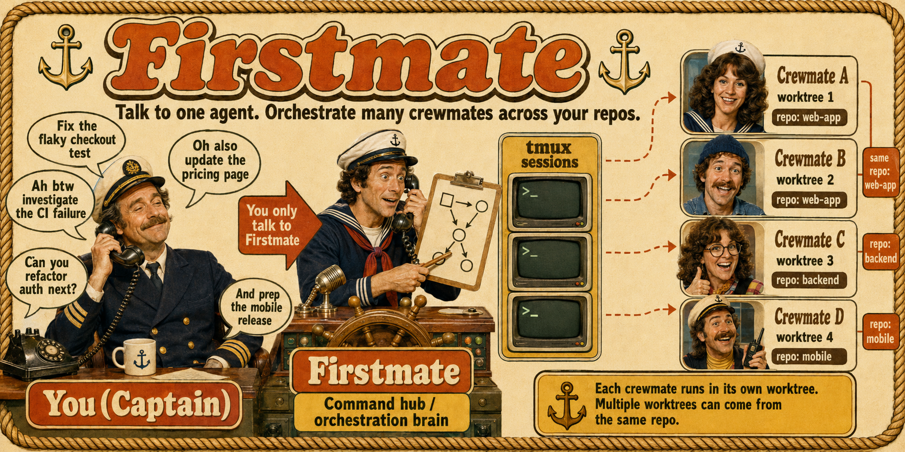

<h1 align="center">firstmate</h1>
<p align="center">
  <a
    href="https://img.shields.io/badge/platform-macOS%20%7C%20Linux-blue?style=flat-square"
    ></a>
  <a href="https://x.com/kunchenguid"
    ></a>
  <a href="https://discord.gg/Wsy2NpnZDu"
    ></a>
</p>

<h3 align="center">Talk to one agent. Ship with a crew.</h3>

<p align="center">
  
</p>

## What it is

You can run one coding agent easily.
But the moment you want three project tasks done in parallel - fixes, investigations, plans, audits - you become a tab-juggler: babysitting sessions, copy-pasting context between repos, forgetting which terminal had the failing test.

firstmate flips the model.
You talk to a single agent - the first mate - and it runs the crew for you: spawning autonomous agents in a visible session backend, giving each a clean git worktree, supervising them to completion, and handing you finished PRs, approved local merges, or standalone investigation reports.

firstmate is not a model, not a harness, not a skill, not an MCP server, and not a CLI.
firstmate is an agent distro for running a crew of agents.
An agent distro is a portable directory of instructions, skills, tooling, policies, and state conventions that turns a general-purpose agent into a specialized one.
There is no app to install: the cloned repo is the distro - `AGENTS.md`, bundled firstmate skills, and helper scripts that any terminal coding agent can follow.
Launching a supported harness inside it for your primary session instantiates your first mate - and makes you the captain.

## Features

- **One liaison** - you talk only to the first mate; it dispatches, supervises, escalates only real decisions, and reports plain outcomes.
- **A visible crew** - every crewmate works in its own Herdr tab you can watch or type into; the first mate reconciles.
- **Disposable worktrees** - each task runs in a clean [treehouse](https://github.com/kunchenguid/treehouse) git worktree, so parallel work on one repo never collides.
- **Two task shapes** - ship tasks deliver authorized changes; scout tasks leave standalone investigation reports when the intake contract warrants separate research.
- **Explicit project modes** - each project ships via `no-mistakes`, `direct-PR`, or `local-only`, with an optional `+yolo` merge-autonomy flag.
- **Event-driven, zero-token supervision** - a bash watcher sleeps on the fleet and wakes the first mate only when something needs you; verified primary harnesses also get a turn-end backstop that blocks or follows up on a blind stop when work is under way and supervision is not live.
- **Optional Feishu channel for Pi** - configure one protected gitignored local file to pair one allowlisted Feishu user and P2P chat automatically with the exact current persisted Pi session, receive through the official Node SDK long connection, submit durable Feishu events with native steering without intercepting TUI input, and mirror finalized Assistant text from that session to the bound chat with exact generation and persisted-entry fencing.
- **Optional Relay** - opt in with one local `.env` pairing token so firstmate can answer your public mentions on X and Discord alike, act on normal reversible mention requests through the same lifecycle as chat requests, acknowledge spawned work, and post up to three public-safe completion follow-ups within seven days for genuine milestones and the final outcome without changing non-Relay behavior; a final reply promised in a thread becomes durable state that is reconciled from disk, so a restart or a compacted conversation cannot lose it; dry-run preview records would-be replies and dismissals locally before go-live.
- **Strict project boundary** - the first mate is read-only over your projects except for the narrow guarded and captain-approved operations authorized by [hard rule 1](AGENTS.md#1-identity-and-prime-directives), including fleet sync's guarded safe branch pruning; crewmates make every other project change behind the configured merge authority.
- **Restart-proof** - all state lives on disk and in the Herdr session; kill the session anytime and the next one reconciles ordinary work and carries on.

Full detail on every feature lives in [docs/architecture.md](docs/architecture.md).

## Quick Start

### Requirements

- Pi or Codex for the primary session; TraeX is supported for Herdr workers and scouts.
- Git and the GitHub CLI, authenticated through `gh auth login`.
- Herdr, jq and Treehouse for terminal and isolated worktree management.

The first mate detects and offers to install supported missing tools after you approve.
Backend-specific setup is linked in [Documentation](#documentation).

### Supported harnesses

Pi and Codex support primary, worker, and scout sessions.
Pi uses tracked watcher extensions; Codex uses bounded foreground supervision checkpoints.
TraeX supports workers and scouts on Herdr only.
Choose one of these three harness names explicitly; removed harness settings are refused rather than silently replaced.

### Install and launch

```sh
gh auth login
git clone https://github.com/kunchenguid/firstmate
cd firstmate
pi
# Alternatively:
codex
```

AGENTS.md governs the primary session after launch.
For Pi, approve the project trust prompt once per clone on first launch so the tracked `.pi/extensions/*.ts` files auto-load.
Pi's `/calm` toggle hides supported transcript chrome, including canonically classified Firstmate operational user rows, and uses a Calm-only animated working boat during active runs while preserving all model context and session data.
Those Calm-hidden operational inputs remain ordinary user-role messages with unchanged delivery, ordering, authority, persistence, and exports.
The preference persists for the effective Firstmate home, and toggling it off restores ordinary rendering.
[Calm's current behavior and supported limits](docs/calm.md) are separate from its [version-scoped maintainer evidence](docs/calm-mode-feasibility.md).
Pi's `/supervision-model` command pins a cheaper model and a shallower reasoning effort for the supervision branch alone, from the eligible models and thinking levels Pi itself reports, and with no pin the branch normally follows your own conversation's model and effort; see the [configuration schema](docs/configuration.md#pi-supervision-branch-model-and-effort-configsupervision-branch-model-configsupervision-branch-effort).
Pi's `/supervision-status` command toggles a read-only view of current branch activity and recent outcomes; see the [state meanings and evidence limits](docs/pi-supervision-branch.md#activity-in-the-pi-terminal).

### Talk to it

```sh
> ahoy! look at my github project xyz, then fix the flaky login test and add dark mode

# firstmate checks its toolchain (asking your consent before installing anything),
# clones the project under projects/ and spawns two isolated workers in the active backend.
# Minutes later:

  PR ready for review, captain: https://github.com/you/xyz/pull/42
  (fix flaky login test - risk: low - CI green)

> alright merge it
```

### Terminal setup

The Herdr setup guide is linked in [Documentation](#documentation) below.

## How It Works

```
            you (the captain)
                  │  chat: requests, decisions, "merge it"
                  ▼
 ┌─────────────────────────────────────┐
 │ firstmate            (this repo)    │
 │ reads projects/ + firstmate routes  │
 │ writes guarded backlog/briefs/state │
 └──┬──────────────┬───────────────┬───┘
    │ backend sends / status files │
    ▼              ▼               ▼
 ┌────────┐   ┌────────┐      ┌────────┐
 │fm-task1│   │fm-task2│  ... │fm-taskN│   Herdr tabs
 │crewmate│   │crewmate│      │crewmate│   one autonomous agent each
 └───┬────┘   └───┬────┘      └───┬────┘
     ▼            ▼               ▼
                 Treehouse worktree
     │
     ├─ ship: project mode ► PR/local merge ► teardown
     │
     └─ scout: report at data/<id>/report.md ► decision inventory ► relay findings ► teardown
```

You chat with the first mate.
It routes each request to a crewmate in its own session endpoint and git worktree, supervises the fleet with a zero-token event-driven watcher, and brings you finished PRs, approved local merges, or investigation reports.
Dispatch profiles let you steer which harness handles which task, and opt-in Relay lets the same fleet answer public mentions.

Full architecture - the supervision engine, worktree isolation, dispatch profiles, project modes, optional Relay, fleet sync, and self-update - is in [docs/architecture.md](docs/architecture.md).

## Built-in skills

Firstmate ships these user-invocable built-in skills.
Pi uses the commands shown here; Codex invokes skills with `$`, such as `$afk`.

| Skill              | What it does                                                                                                                                  |
| ------------------ | -------------------------------------------------------------------------------------------------------------------------------------------- |
| `/afk`             | Enter away-mode supervision: the sub-supervisor self-handles routine notifications in bash, escalates captain-relevant events and bounded declared-external-wait rechecks as batched digests, and actively alerts if delivery gets stuck while you step away |
| `/quiet`           | Enter quiet supervision mode: the same token-saving sub-supervisor tradeoff as `/afk`, for a captain who is staying and chatting - ordinary messages do not exit it, only an explicit `/quiet off` does |
| `/ahoy`            | Recap visible session events since the prior real captain message plus visibly unanswered captain decisions, then guide the captain through any open decisions one at a time in agent-judged impact order; fall back to Bearings when invoked as the session's first real captain message |
| `/bearings`        | Generate a concise four-section chat digest from bounded fleet state; use `/bearings file` to also replace today's dated report in `data/`, and add `include PRs` for live GitHub enrichment |
| `/updatefirstmate` | Guardedly update the running firstmate - fast-forward, or reconcile a redundant post-squash-merge divergence - and restart it on the target commit |
| `/stow`            | Sweep the session for uncaptured durable knowledge, persist the open work records this session knows are unfiled or now wrong, curate tiered startup memory with decay and cold archival, enforce the home budget or surface the required decision, and report what is safe to reset |

Bearings invocation examples:

- `/bearings` returns the fresh four-section digest in chat only.
- `/bearings include PRs` keeps chat-only mode and opts into live PR enrichment.
- `/bearings file` replaces today's `data/status-report-<YYYY-MM-DD>.md` from scratch and links it from the four-section chat digest.
- `/bearings file include PRs` combines the dated report with live PR enrichment.

Agent-only reference skills live under `.agents/skills/` and are loaded by firstmate at the trigger points named in [`AGENTS.md`](AGENTS.md).

### Two-tier skill layout

Firstmate's skills live in two separate places with different audiences:

- `.agents/skills/` - agent-loaded skills (this section's table, plus firstmate's agent-only reference skills). Every one of these assumes a live firstmate home and is meaningless, or actively misleading, installed anywhere else, so each carries `metadata.internal: true` in its frontmatter. That flag hides them from installer discovery (tools like the [skills.sh](https://skills.sh) `npx skills add` installer) without affecting how firstmate itself loads them - frontmatter metadata is inert to the agent's own skill loader.
- `skills/` - public, installer-facing skills meant to be installed standalone into any project, independent of firstmate.
  Each one is a self-contained skill with no dependency on firstmate's paths, tools, or vocabulary.
  Today that is `skills/stow`, a generic session-knowledge-sweep skill that routes findings by explicit instruction first, then existing local conventions, then a private `.stow-notes.md` fallback, and curates tiered entries through decay, local archival, and user-approved on-demand offload proposals.
  It intentionally shares no code with the firstmate-internal `.agents/skills/stow` it is named after, so the two can evolve independently.

## Documentation

- [docs/architecture.md](docs/architecture.md) - maintainer architecture for the crew, supervision, worktrees, and project modes.
- [docs/configuration.md](docs/configuration.md) - environment variables, `FM_HOME`, runtime backend selection, optional Relay and its X and Discord setup steps, trusted external process-event adapter setup, the files you set, and harness support.
- [docs/feishu-channel.md](docs/feishu-channel.md) - opt-in pairing, exact Pi session binding, supported P2P behavior, transport operation, safety boundaries, and recovery for the private Feishu channel.
- [docs/extension-bindings.md](docs/extension-bindings.md) - maintainer architecture for the narrow trusted external `process-event-adapter/1` package, binding, handshake, and evidence boundary.
- [docs/calm.md](docs/calm.md) - current Pi `/calm` behavior and supported presentation limits.
- [docs/wedge-alarm.md](docs/wedge-alarm.md) - configure the active alert for an away-mode escalation delivery that gets stuck.
- [docs/herdr-backend.md](docs/herdr-backend.md) - current setup, CI coverage, safety boundaries, and limits for the Herdr backend.
- [docs/verification/runtime-backends.md](docs/verification/runtime-backends.md) - active maintainer verification for runtime backend guarantees.
- [docs/gitlab-merge-watch.md](docs/gitlab-merge-watch.md) - maintainer verification for watching and merging GitLab merge requests on arbitrary instances.
- [docs/turnend-guard.md](docs/turnend-guard.md) - the primary session's current "no turn ends blind" backstop, scope, loop safety, and compatibility limits.
- [docs/verification/supervision.md](docs/verification/supervision.md) - active maintainer verification for session-start, guard, continuity, and wedge integrations.
- [docs/supervision-protocols/](docs/supervision-protocols/) - rendered primary-harness watcher protocols for Pi, Codex, and the unknown-harness boundary.
- [docs/scripts.md](docs/scripts.md) - the `bin/` toolbelt reference.
- [docs/documentation-audiences.md](docs/documentation-audiences.md) - documentation audiences and the machine-checked placement boundary.
- [`AGENTS.md`](AGENTS.md) - the supervisor contract, role boundary, and routing index for conditional procedures.
- [CONTRIBUTING.md](CONTRIBUTING.md) - how to contribute, including the dev/test commands.

## Contributing

Contributions are welcome - see [CONTRIBUTING.md](CONTRIBUTING.md) for the workflow, repo conventions, and how to run the tests.

## License

MIT - see [LICENSE](LICENSE).
