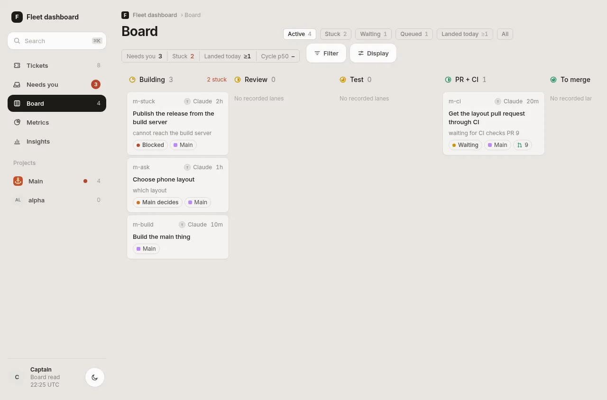

<div align="center">

<h1>Juggernaut</h1>

*Ship like it's a game.*

**Talk to one agent. It runs the squad and ships the work.**

For developers running several coding agents at once: clone this repo, give your agent a mission, and collect finished pull requests, approved local merges and recon reports instead of a wall of terminal tabs.

<picture>
  <source media="(max-width: 600px) and (prefers-color-scheme: dark)" srcset="docs/media/hero-phone-dark.webp">
  <source media="(max-width: 600px)" srcset="docs/media/hero-phone-light.webp">
  <source media="(prefers-color-scheme: dark)" srcset="docs/media/hero-dark.webp">
  
</picture>

<sub>The fleet board, served by this repository, on a demo fleet.</sub>

[Quick start](#quick-start) · [Add-ons](addons/README.md) · [Documentation](#documentation) · [Vision](VISION.md)

[](https://github.com/umeranjum17/juggernaut/actions/workflows/ci.yml)
[](LICENSE)


</div>

## Quick start

### Requirements

- git, and the [GitHub CLI](https://cli.github.com) signed in with `gh auth login` for the pull requests.
- One verified agent harness on your PATH.
  The first launch checks for it, and offers to install anything missing.

### Three commands

```sh
git clone https://github.com/umeranjum17/juggernaut
cd juggernaut
claude
```

Any verified harness works: `grok --trust`, `pi`, `omp`, `codex`, `opencode`, or `cursor-agent --trust`.

The session you just opened is your Overwatch, and you are its Captain.
So there is no app, no server and no account: the repository is the product.

### A first mission

```text
> ahoy - look at my project xyz: fix the flaky login test, then add dark mode

  Two operators away: one on the flaky login test, one on dark mode.
  They work in their own copies, and report back here.

> what's the state

  1 running · 1 ready · 0 stuck
  PR ready for review, Captain: https://github.com/you/xyz/pull/42 (CI green, risk low)

> merge it
```

## Why Juggernaut

| Doing it by hand today | With Juggernaut |
| --- | --- |
| You keep several terminals open and remember what each one was doing | You talk to one agent, and it holds the whole fleet's state on disk |
| Every session edits your checkout, so parallel work collides | Each mission gets its own disposable git worktree and its own operator |
| You notice a dead run when you get back to that tab | A zero-token watcher wakes the Overwatch only when something needs a person |
| You re-read diffs to decide what is safe to merge | Work lands through the mode you set per project, and only a green, in-scope result reaches the merge |
| A restart or a closed laptop loses the thread | State, decisions and promises live in durable records, so the next session reconciles and resumes |

## What one clone gives you

- **The base.**
  One contract the agent follows ([`AGENTS.md`](AGENTS.md)), the `bin/` toolbelt that owns the exact mechanics, the skills, and the docs that explain them.
- **Every add-on.**
  50 add-ons under [`addons/`](addons/README.md), each with its own installer and tests: safety guards for delete, kill and read, memory and quota gates, stall and rotation alerts, the dashboard, Lookout and sign-off adapters, and more.
  Install one, remove one, ignore the rest; [the catalog](addons/docs/addons-reference.md) lists them all.
- **The toolchain gate.**
  The first launch checks the tools a home needs and refuses to guess about versions: no-mistakes 1.46.0, gh-axi 0.1.29, learn-from-mistakes 0.2.0, lavish-axi 0.1.80, plus node, git, gh, tasks-axi and quota-axi.
- **Pinned companions.**
  done-done, sign-off, learn-from-mistakes, first-draft, Lookout, quota-axi and BYOKit each stay their own repository with their own release, and Juggernaut calls them through their CLIs at the version an integration is proven against, such as done-done-axi 0.6.4 in the merge gate and sign-off-axi 0.6.9 in the tickets-sync checks.
  Nothing of theirs is vendored here: the clone holds the pins and the adapters, not their code.

## What it looks like

The board answers the only question that matters when you look away: what needs me.

```text
3 need you · 4 in flight · 2 stuck · ≥1 landed today

m-stuck   Blocked   Publish the release from the build server
m-ci      Waiting   Get the layout pull request through CI
```

That sitrep line and those two lanes come from the demo fleet in the board above, arranged in columns.
The lines a mission writes for you are just as short: `working`, `paused` with what it is waiting for, `blocked` with the cause, `needs-decision` with the choice, and `done` with the pull request it landed.

## How it works

```text
            you (the Captain)
                  │  chat: missions, decisions, "merge it"
                  ▼
 ┌─────────────────────────────────────┐
 │ Juggernaut          (this repo)     │
 │ reads projects/ + Juggernaut routes │
 │ writes guarded backlog/briefs/state │
 └──┬──────────────┬───────────────┬───┘
    │ backend sends / status records │
    ▼              ▼               ▼
 ┌────────┐   ┌────────┐      ┌────────┐
 │ task 1 │   │ task 2 │  ... │ task N │   tmux windows, herdr or zellij tabs, cmux workspaces, Orca terminals
 │operator│   │operator│      │operator│   one autonomous agent each
 └───┬────┘   └───┬────┘      └───┬────┘
     ▼            ▼               ▼
  treehouse worktree, Orca worktree, or an isolated secondmate home
     │
     ├─ mission: project mode ► PR or local merge ► cleanup
     │
     └─ recon: report at data/<id>/report.md ► decision inventory ► findings
```

You chat with the Overwatch.
It routes each request to an operator in its own session endpoint and git worktree, supervises the squad with a zero-token event-driven watcher, and brings you finished pull requests, approved local merges, or recon reports.
Opt-in secondmates extend the same shape to persistent mates in their own isolated homes on this machine or another host, dispatch profiles steer which harness handles which mission, and opt-in Relay answers public mentions in the same lifecycle.
The full architecture is in [`docs/architecture.md`](docs/architecture.md).

### How work lands

Every project has a delivery mode, and the Overwatch refuses to guess it.

| Mode | What the worker does | Who merges |
| --- | --- | --- |
| `no-mistakes` | Runs the validation pipeline: review, tests, docs, push, PR, CI | The configured merge authority |
| `direct-PR` | Pushes a branch and opens a pull request | The configured merge authority |
| `local-only` | Leaves a clean branch to fast-forward locally | The configured merge authority |

An optional `+yolo` flag lets the Overwatch merge green, in-scope work itself; without it, every merge waits for your word.
Destructive, irreversible and security-sensitive merges always come back to you.
Modes, branch prefixes and forge bindings are in [`docs/configuration.md`](docs/configuration.md).

### Harnesses and backends

Claude Code, Grok and Pi are the three co-primary harnesses, with `pi-signed` as Pi's signed wrapper.
Oh My Pi (`omp`), Codex, OpenCode and Cursor Agent CLI are verified too; [harness support](docs/configuration.md#harness-support) owns the setup and the limits of each.

tmux is the reference session backend, and herdr is supported alongside it.
zellij, Orca and cmux are experimental backends on the same contract; each backend doc owns its setup and limits.

## Add-ons

The add-ons are optional by design: nothing in the base requires one, and the base keeps working after you remove one.
Start from [the add-on catalog](addons/docs/addons-reference.md), or go straight to the job in front of you:

- **Protect the machine and the fleet**: [host-memory](addons/host-memory/README.md) (a memory gate for heavy jobs), delete, kill and read guards.
- **Keep work moving**: [fleet-stall](addons/docs/addons-reference.md#fleet-stall), [quota-failover](addons/docs/addons-reference.md#quota-failover), [account-pool](addons/account-pool/README.md).
- **Ship checked work**: [merge-on-green](addons/merge-on-green/README.md), [merge-card](addons/merge-card/README.md), [receipts](addons/receipts/README.md).
- **Watch the fleet**: [fleet-dashboard](addons/fleet-dashboard/README.md), [lookout-adapter](addons/lookout-adapter/README.md), [fleet-pulse](addons/fleet-pulse/README.md).
- **Answer decisions**: [signoff](addons/signoff/README.md), [ask-default](addons/docs/addons-reference.md#ask-default), [owner-rules](addons/owner-rules/README.md).
- **Tickets and sync**: [tickets-sync](addons/tickets-sync/README.md), [bearings-board](addons/bearings-board/README.md).

Each directory carries its own `README.md` with the exact install, uninstall and test commands.

## Built-in commands

| Command | What it does |
| --- | --- |
| `/ahoy` | Recap the session, then walk you through any open decision one at a time |
| `/bearings` | A four-section fleet sitrep from disk state; `file` also writes today's report, `include PRs` adds live pull-request data |
| `/afk` | Hand routine watching to the away-mode supervisor while you step out, and brief you on return |
| `/quiet` | Keep routine wakes off the chat while you stay in the session; `/quiet off` ends it |
| `/stow` | Sweep the session for durable knowledge and file it where it belongs before a context reset |

Agent-only reference skills live under [`.agents/skills/`](.agents/skills) and load at the trigger points named in [`AGENTS.md`](AGENTS.md).
Public installer-facing skills live under [`skills/`](skills), and [`docs/documentation-audiences.md`](docs/documentation-audiences.md) owns which surface holds what.

## Documentation

- [docs/architecture.md](docs/architecture.md) - how supervision, worktrees, secondmates, dispatch and project modes work.
- [docs/configuration.md](docs/configuration.md) - environment variables, the home layout, backend selection, harness support, Relay and dispatch rules.
- [docs/scripts.md](docs/scripts.md) - the `bin/` toolbelt reference.
- [docs/tmux-backend.md](docs/tmux-backend.md), [docs/herdr-backend.md](docs/herdr-backend.md), [docs/zellij-backend.md](docs/zellij-backend.md), [docs/orca-backend.md](docs/orca-backend.md), [docs/cmux-backend.md](docs/cmux-backend.md) - setup and limits for each session backend.
- [docs/remote-secondmates.md](docs/remote-secondmates.md) - running a whole second mate home on another host.
- [docs/calm.md](docs/calm.md), [docs/voice-relay.md](docs/voice-relay.md) - optional presentation and spoken-interface layers.
- [docs/wedge-alarm.md](docs/wedge-alarm.md), [docs/fleet-ledger.md](docs/fleet-ledger.md) - the stuck-delivery alarm and the read-only activity ledger.
- [docs/verification/](docs/verification) - the maintainer verification records behind the guarantees above.

## Contributing

Contributions are welcome.
Read [CONTRIBUTING.md](CONTRIBUTING.md) for the workflow, the repo conventions, and how to run the tests.

## License

MIT - see [LICENSE](LICENSE).
Juggernaut is a fork of [Firstmate](https://github.com/kunchenguid/firstmate) by Kun Chen; the original MIT copyright and licence notice are preserved in [LICENSE](LICENSE).

## Star history

<a href="https://www.star-history.com/?repos=umeranjum17%2Fjuggernaut&type=date&legend=top-left">
 <picture>
   <source media="(prefers-color-scheme: dark)" srcset="https://api.star-history.com/chart?repos=umeranjum17/juggernaut&type=date&theme=dark&legend=top-left" />
   <source media="(prefers-color-scheme: light)" srcset="https://api.star-history.com/chart?repos=umeranjum17/juggernaut&type=date&theme=light&legend=top-left" />
   
 </picture>
</a>
