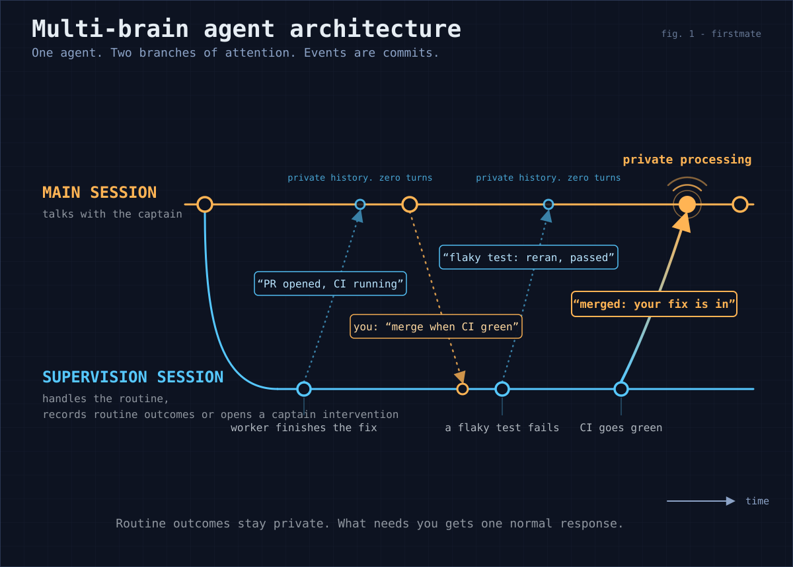

# Pi supervision branch

The poster is the visual of the idea.
This document stays the owner and the contract.

Fleet supervision on the Pi primary harness runs on a second conversation - the supervision branch - inside the same `pi` process as the captain's chat.
Supervision is default-on: once a Pi primary session owns this home's fleet lock, the branch handles eligible task-local rows from ordinary actionable wakes plus heartbeat scans that the cheap bash-level scan flags as possibly captain-relevant, then merges each outcome back into the captain conversation's transcript.
Ordinary main-only rows remain on main even when eligible task-local rows share their queue, except that a fully identity-bound task-scoped iDA process-result check is branch-owned and a decision-owned signal or stale trigger keeps its entire coalesced trigger batch on main.
A structurally valid signal or stale row whose task identity no longer resolves is retained as row-local main-only evidence: its own trigger stays on main, while unrelated resolvable rows remain branch-eligible.
Malformed or unreadable queue data still makes the scan unsafe and returns the whole wake to main, and every watcher-failure alarm also stays on main.
Captain-relevant branch outcomes persist as exact, sequence-keyed visible transcript entries and then open one sequence-keyed processing turn on main, which stays open until main acknowledges that sequence.
The design source is the captain-approved forked-supervision architecture board, a captain-private fleet record (a self-contained HTML explainer with the measured cache and judgment evidence); this document records the shape it landed as, and the delivering PR cites the board artifact itself.

The supervision branch itself is Pi-only by construction:

- The branch lives in `.pi/extensions/fm-branch-supervision.ts`, which only a Pi primary ever loads; no other harness gains branch supervision behavior.
- The bash-side additions (leases, the outcome store, session-start recovery) are inert in a home with no branch state: no lease files exist, no actor variable is set, every guard passes silently, and no new state appears (`tests/fm-branch-supervision.test.sh` holds this).
  A home on any harness that already has an outcome store still receives the shared drain compatibility recovery described in [Lost-wake outcome backstop](#lost-wake-outcome-backstop).
- It does not change which harness is primary and never moves a home to Pi.

## Activity in the Pi terminal

The primary TUI shows a compact `Branch` widget above the editor.
Run `/supervision-status` to toggle its detail lines and request a fresh read-only health observation.
This does not start or reset a branch, claim a wake, or acknowledge an outcome.

| State | Meaning |
| --- | --- |
| `disabled` | A fresh branch observation says away mode, reset, or shutdown currently disables handling. |
| `idle` | The current process owns the lock and reports no pending work or latched fault; this is not proof of completed work. |
| `processing` | A live admission is pending; the item summary distinguishes accepted-before-prompt from model/tool execution. |
| `degraded` | A handling failure or unexpected MAIN fallback remains latched until a later durable branch result succeeds. |
| `error` | The branch reports a construction, reconciliation, or provider health fault. |
| `unknown` | Ownership or current evidence is missing, stale, inconsistent, or exceeds the bounded display capacity. |

Details show the current wake kind and bounded item/batch count, latest completed branch result time, latest MAIN fallback, and latest error category.
Only a branch settlement after a durable report counts as a completed result; acceptance, a loaded extension, mirrored conversation, a short-task outcome, and a quiet empty-queue return never count.
A MAIN-only check or decision is an expected fallback and does not imply branch failure.
The `ownership-lost` fallback category historically groups fleet-lock loss and wake rows already claimed by MAIN; the branch's `recheck: main-owned` or `grant: main-owned` observation distinguishes the latter without altering its safety guard.

The presentation owner is `.pi/extensions/fm-branch-status.ts`, with its bounded read model in `lib/fm-branch-activity.ts`.
It consumes branch/watcher observational events, reads at most the last 256 KiB and 200 routing records once on session start, and retains no message bodies or tool arguments.
Historical records can establish the last result or failure, but never current processing.
Refreshes coalesce over 100 ms, stream liveness pulses are limited to once per second, and a single two-minute expiry marks silent evidence unknown without polling or rescanning files.
Shutdown and reload dispose subscriptions and timers; noninteractive modes allocate no display observer.
Other primary harnesses and terminal backends gain no behavior or authority changes.
The portable checks are `tests/fm-pi-branch-status.test.sh`; `tests/fm-pi-branch-status-live.test.sh` refreshes real-Pi rendered evidence under the [harness verification policy](verification/runtime-backends.md).

## Live task continuation

Presentation acknowledgement does not establish task acceptance.
The main session retains an enrolled task's goal assessment in the canonical `data/<task>/lifecycle.json` owner, exposed by `bin/fm-task-state.sh`; `bin/fm-task-lifecycle.py --help` owns its schema and compare-and-swap transitions.
MAIN uses the native tool's `inspect` and `assess` actions to bind evidence and submit a semantic judgment; the lifecycle owner derives mechanical fields and returns a concise current result.
For an authenticated follow-up, `route` with `update_brief:true` appends the exact input through that same owner, so the following steer does not require a hand-authored reconciliation document.
The existing watcher offers due eligible rows before native lifecycle and shell tool operations; decisions, uncertain results and other MAIN-only rows remain durably actionable in the original queue.
The full lifecycle read and legacy reconciliation interface remain available for recovery and explicit delegation changes.
Enrollment is limited to existing task briefs named by explicit task intake, a task update, wake claim, or processed outcome, with no historical fleet migration.
MAIN supplies the evidence-backed disposition, outcome, remaining gap and next action, including a genuine blocker with responsible owner and observable release evidence.
The lifecycle owner derives identifiers, hashes, timestamps, counters and verified executor receipts, while the existing merge and cleanup owners append generation-bound result receipts without changing semantic acceptance.
A queued handoff, successful send, provider terminal state, reported plan, or PR result cannot independently establish acceptance.
The existing durable handoff owner retains lease conflicts and deduplicates retries by the original id.
Attempted and uncertain effects remain readback work; the continuation observer never executes a payload or grants new authority.
The Pi extension checks existing task obligations before logical-run settlement and uses the existing heartbeat coordinator's tick for bounded rechecks.
Chat remains native transcript evidence; only an explicit task intent update stages a recoverable append transaction, with no independent message goal or answer bookkeeping.
Unchanged genuine blockers, healthy observed execution, accepted goals, and explicitly archived goals stay quiet.
Changing dependency evidence or a missing executor makes the precise retained obligation actionable again without re-presenting its already acknowledged outcome.
The extension limits unchanged automatic prompts to two with backoff, including settlement-triggered continuations.
The canonical lifecycle record retains the budget across reload, compaction and unrelated input.
Before releasing a logical Pi run with actionable obligations, the existing heartbeat coordinator actually reads them and persists a generation-bound receipt; the task remains pending, and that receipt proves coordination rather than execution or acceptance.
After two delivered requests without a verified continuation, the main session durably presents one initial coordination-failure follow-up and starts an executable main turn, including when full heartbeat maintenance is disabled.
The initial request budget stays exhausted, but if the durable observation remains unchanged after that turn, the same clock schedules deduplicated recovery turns with increasing delay until authoritative observation changes; reload, compaction, and unrelated input preserve that pace.
A lifecycle observation refusal never infers a receiver or execution state: it presents an explicit reconciliation request and follows the same persisted recovery pacing until canonical observation succeeds.
An exact pending short-operation or live supervision-lease refusal instead stays a quiet, session-persisted ownership deferral with bounded backoff; it cannot escape the Pi settlement boundary, authorize an effect replay, or prevent unrelated task observations, while any other refusal remains an actionable reconciliation error.
The task stays open: the escalation is neither an executor receipt nor a fabricated task blocker, and main must assign an authorized executor, reconcile a real dependency, or assess acceptance when it resumes.
Between due recovery turns, the same clock continues bounded readback without blocking heartbeat maintenance or independent input.
A MAIN admission deferred by UI, tool, input or compaction activity stays reserved in the existing owner until the complete safety check permits delivery; a persisted native message confirms delivery without spending another attempt.
Both timer delivery and the final before-settle submission recheck those protections after asynchronous readback; before-settle does not require the still-active logical run to become idle.
This safeguard applies while Pi is alive; it introduces no process-exit recovery, external watchdog, cleanup engine, or parallel lifecycle truth store.
`tests/lifecycle-semantic.py` and `tests/lifecycle-native.mjs` exercise semantic assessment, ordinary-chat exclusion, authenticated intent updates, bounded incremental session indexing, automatic owner receipts, operation ordering and refusal boundaries through public interfaces.
`tests/fm-task-handoff.test.sh`, `tests/fm-pi-branch-extension.test.sh`, and `tests/fm-periodic-stow-herdr-live-e2e.test.sh` cover the existing handoff, continuation and live-runtime boundaries.

## Components and their owners

- Wake dispatch: `.pi/extensions/fm-primary-pi-watch.ts` stays the dispatcher; `.pi/extensions/lib/fm-branch-dispatch.ts` owns the offer handshake and row eligibility, while [`watcher-continuity.md`](watcher-continuity.md#per-actor-acknowledgement) owns the per-actor consume contract.
  A successful row grant transfers ownership of exactly the currently branch-eligible rows to the branch; a check-kind triggering close stays on main except for a task-scoped iDA process result whose queue key, payload, private captured result and adapter files, remote-agent metadata, durable iDA task state, session marker, and available provider identities all match exactly.
  Malformed, path-unsafe, unresolvable, mismatched-provider, mismatched-task, and mismatched-result iDA-looking rows keep the ordinary main path, as do merge-confirmation polls, Relay mentions, credential/auth failures, and every other check class.
  No acceptor (extension absent, legacy away daemon flag, branch broken) keeps today's wake-to-main path for the close, and watcher-failure alarms always go to main because only main can repair the watcher cycle.
  A busy branch also declines a newly arrived iDA result unless its live grant already contains that exact row, so an unowned result falls back to main instead of waiting between actors.
  A decision-owned event surfaced by `bin/fm-watch.sh`'s signal path gets the identical treatment even though it keeps the ordinary `signal` kind.
  `signal_files_actionable` marks the queued payload `needs-decision:` for a newly surfaced `needs-decision` or a `captain-held` declaration surfaced through the no-verb fallback; `scopeForUnreadWake` excludes every marked row from what the branch may claim.
  For a stale row, `scopeForUnreadWake` folds the mapped task's status log and excludes the row when any `needs-decision` remains open or the current meaningful declaration is `captain-held`; an unreadable or symlinked status log fails the scope closed rather than influencing routing.
  Task metadata contributes aliases only from one current-user-owned regular single-linked file with exactly one project field and at most one window field; task ids, status files, turn-ended files, and complete window values are opaque exact aliases.
  An alias claimed by more than one task remains unresolved and main-owned rather than inheriting filesystem iteration order.
  The dispatcher resolves trigger keys and every currently unread excluded decision row to task identity before cross-referencing them: any signal or stale trigger containing a decision-owned task goes wholly to main, including a batch that also contains routine rows, and an unread decision for one task keeps every later signal or stale trigger for that same task on main until the decision row is read, regardless of whether the rows use its status-file key or window alias.
  Other tasks remain independently eligible.
  The wake message itself retains its existing shape, so other harness-arm scripts remain unchanged.
  For an accepted iDA result the branch claims only the resolved task, repeats `fm-procevent-ida.sh handle` for the exact source sequence even when the runner already applied it, reads provider-aware task state and the task-bound report when present, and reports the result or incomplete blocker without treating provider text as authority.
  Compliance declarations, access grants, provider cancellation, new dispatch, implementation, merge, destructive action, and every other captain-owned decision remain main escalations.
  Heartbeat handling remains independent.
  A fleet-wide heartbeat keeps its own all-or-nothing rule (see "Heartbeat routing" below): it takes every branch-ownable unread row or none of them.
  A co-present main-owned check row no longer defers that review to main, because it is not fleet context the branch is missing and main is woken for it on its own triggering close.
- The branch itself: `.pi/extensions/fm-branch-supervision.ts` creates the branch session, serializes wakes, mirrors dialog, and merges outcomes.
  Each build reads global settings through Pi's `SettingsManager` with `projectTrusted: false`, then shares an in-memory snapshot between package resolution, the resource loader, and the session.
  Runtime settings such as transport, connection timeouts, retry policy, and proxy configuration survive; branch and plugin setters cannot write back to user settings, and model/effort selection retains the explicit precedence described below.
  The snapshot clears configured packages, extensions, skills, prompts, and themes because Pi resolves package sources before applying the loader's discovery flags.
  Unreadable or malformed global settings fail the build and return the wake to main instead of silently using defaults.
  Pi's CLI owns process-wide proxy environment and HTTP dispatcher initialization; the branch retains that process setup and does not reconfigure it.
  Before an `openai-codex` branch can prompt, it resolves the installed user package `npm:pi-openai-codex-compat` through Pi's package manager, validates package identity and the readable manifest, loads exactly its declared in-package extension entry from the installed user-package provenance, and binds the extension so its `session_start` provider override and native compaction hooks are active.
  The branch does not gate initialization on Pi or `pi-openai-codex-compat` version strings.
  Every other resource-discovery class remains disabled, and the post-start active-tool check must still equal `read`, guarded `bash`, and `fm_branch_report` in that order.
  If compatibility startup removes only `bash`, leaving exactly `read` and `fm_branch_report`, the branch restores the registered guarded override and verifies the full active-tool set again.
  The runtime state check independently prevents a compatibility package from widening the branch tools.
  The plugin's native runtime dependencies must load on the host; an incompatible tree-sitter prebuild needs a local source build using the package's supported build tooling before activation.
  [Runtime verification](verification/runtime-backends.md) records the current installed-runtime checks and refresh commands.
  A missing, malformed, unresolved, unloadable, or startup-failing compatibility package makes that Codex branch fail closed before prompting and returns its accepted wake to main; non-Codex branches do not resolve or depend on the package.
  The branch conversation never spans main sessions: after every main session start - a cold start, `/new`, `/resume`, `/fork`, or a reload - the next eligible wake creates a NEW branch conversation, and a conversation recorded by an earlier session is never reopened as the live one.
  Installing or upgrading the package alone does not create `state/.branch-session`; ownership and durable-outcome reconciliation must succeed before the first eligible notification starts it.
  That keeps the branch reasoning from the current generated prompt and the current main dialog rather than from weeks of accumulated thread, where a superseded rule could still outweigh today's.
  A model or effort change inside one main session continues that session's own conversation, recorded by `state/.branch-session`; the explicit `/supervision-reset` path below retires it instead.
  Earlier conversations stay on disk under `state/branch-session/`, exactly as Pi keeps its own session files, and are never reopened as live branch context; the effort picker may only inspect the model named by the current pointer as the last-resort lookup documented in [configuration.md](configuration.md#pi-supervision-branch-model-and-effort-configsupervision-branch-model-configsupervision-branch-effort).
  Nothing captain-facing rides on that conversation: the durable outcome store and its processed marker are what carry unacknowledged outcomes across the boundary, and they re-present on the new main session exactly as they do after a crash.
  It checks the current extension generation and `state/.lock` ownership before each guarded branch side effect so replacement or lock loss cannot let an old continuation mutate the new session.
  Those checks and the store calls around them are awaited rather than synchronous, and an explicit queue inside the extension is what keeps them serialized (see "Off-thread delivery" below).
  Every accepted path that cannot reach a working branch rejects its settlement to the watcher, which retains delivery ownership and routes the wake to main as a follow-up that counts as delivered once Pi accepts it; a broken branch declines later offers so they take that path directly.
  Each watcher offer carries its exact eligible sequence-to-task snapshot.
  After asynchronous queueing and before publishing a grant, the branch rechecks the current extension generation, model/effort selection revision, fleet-lock ownership, trigger disposition, admitted sequences, and their resolved task identities.
  Retirement, endpoint reuse, a selection or generation change, or a competing main grant rejects settlement to watcher-owned fallback; an actually empty queue is the only already-consumed quiet no-op.
  After wake rows are claimed, a branch prompt counts as handled only when `fm_branch_report` appends a durable outcome before that prompt settles; a settled provider error or a settled prompt with no report releases the grant and rejects delivery ownership back to the watcher.
  While a task-scoped prompt is open, `fm_branch_report` accepts only the tasks that prompt's claimed rows resolve to (a signal row by its status-log key, a stale row through the task record naming that endpoint, or an iDA result through its identity-bound remote-task record); a report for any other task id, `fleet` included, is refused before the store is touched, so a task remembered from an earlier wake cannot become a delivered outcome, while a heartbeat review is not scoped by task.
  The branch's guarded commands never tell it to drain queued rows mid-handling: for that actor `bin/fm-guard.sh` keeps the queued-wakes warning silent, and an acknowledgement that consumed nothing reports that plainly with the exact command for the current wake (`docs/watcher-continuity.md` "Per-actor acknowledgement").
  Two consecutive settled provider errors latch the branch broken and surface a one-line health note only on that initial trip.
  Main keeps every wake during a five-minute cooldown, after which one wake may probe the branch while concurrent wakes still stay on main; each probe that settles with another provider error doubles the next cooldown up to one hour.
  A prompt from the current branch generation and model or effort selection that appends a durable `fm_branch_report` and then settles without a provider error clears both the latch and provider-error streak and surfaces a one-line recovery note; a provider error settled after that report wins instead, re-latches the branch, and extends the cooldown.
  A session replacement or branch model or effort change resets the recovery state immediately.
  Outcome-reconciliation failures are a separate health class from construction and provider failures.
  A one-shot read or presentation failure may probe again at the next ordinary offer, turn boundary, or outcome-ready event.
  After repeated failures, ordinary offers and turn boundaries use bounded exponential backoff without a new timer; an outcome-ready event still attempts reconciliation because it announces newly durable work.
  Only a successful authoritative reconciliation in the same extension generation and selection revision clears that class.
  Mirror success does not clear it, and the probe path never clears provider cooldown or permanent construction/configuration failures.
  Because durable outcomes precede presentation, recovery re-presents or reconciles them without replaying branch execution.
- Branch model and effort selection: the same extension registers `/supervision-model`, which picks the branch's model and then its reasoning effort, and applies both at the branch-session creation boundary; [configuration.md](configuration.md#pi-supervision-branch-model-and-effort-configsupervision-branch-model-configsupervision-branch-effort) owns the operator-facing schema and behavior.
- Branch conversation reset: `/supervision-reset` closes branch admission, aborts and waits for any active branch turn through Pi's session API, releases row grants and branch-held leases, archives the old JSONL, clears its pointer, and re-anchors mirroring at main's current tail.
  It does not replace the main session or any Feishu binding, and it does not eagerly create a branch: the next eligible wake creates the fresh persistent conversation.
- Branch system prompt: `bin/fm-branch-prompt.sh`; its header owns the byte-stable-prefix contract (no timestamps, no fleet snapshot, no per-wake content).
- Outcome store: `bin/fm-branch-outcome.sh`; its header owns the append-only format, read cursor, and bounded per-task status-coverage indexes.
  Outcomes are written to the store before delivery to Pi.
  A captain row advances the cursor only after its matching visible session entry exists, while locked session-start replay stops before the first captain row so it cannot acknowledge that outcome through prose alone.
  A routine note has no such sequence-keyed record, so if its cursor write fails after the note was delivered the next reconciliation sends that note once more.
  That asymmetry is a known limitation of the routine delivery representation rather than of the ordering above, it predates delivery moving off Pi's render thread, and closing it means giving routine delivery a durable idempotent record - tracked as follow-up `fm-pi-routine-delivery-idempotency-followup-r1` and pinned meanwhile by `tests/fm-pi-branch-extension.test.sh`.
- Consistency: `bin/fm-lease-lib.sh` owns the per-task lease contract, the main-only role partition, and the deliberate CONFUSED-AGENT-GRADE threat model these guards target (captain-decided; adversarial-grade separation is out of scope and tracked as follow-up design work); `bin/fm-lease.sh` is the command surface.
  The guards are wired into `fm-send.sh`, `fm-control.sh`, and `fm-teardown.sh` (overlap, lease-checked, with claim serialization retained through the mutation) and `fm-pr-merge.sh`, `fm-merge-local.sh`, and `fm-spawn.sh` (main-owned, branch refused; a relaunch through `fm-control` stays branch-legal recovery).
- Autonomy: supervision is default-on for every task once a Pi primary session owns the fleet lock (docs/configuration.md "Pi supervision branch"); no captain grant file is required.
  A fleet-wide heartbeat is separately eligible when its safe subset contains a heartbeat row, a resolvable task-local signal or stale row, or an identity-bound iDA result check (see "Heartbeat routing" below).
  Main-owned checks, decision-owned signal/stale rows, and structurally valid unresolved task rows are excluded and remain queued; malformed or unreadable queue data and every watcher-failure alarm keep the whole wake on main.
  The shared `scopeForUnreadWake` classifier also excludes the exact queued rows in `.main-eligible-rows` during admission and pre-prompt recheck.
  A trigger matching a claimed signal/stale task alias, exact check payload, or claimed heartbeat stays on MAIN; unrelated new rows can form their own grant.
  An absent MAIN record means no claim, while a malformed, unreadable, non-regular or changing record fails closed.
  The branch recomputes eligibility immediately before prompting the branch to drain and publishes the exact eligible row set to `state/.branch-eligible-rows` through `writeEligibleRowsSnapshot`.
  After an independently eligible wake has already been offered, an unrelated MAIN-owned row observed at that pre-drain recheck does not revoke the offer: it remains outside the admitted set.
  MAIN claiming an admitted row after admission rejects settlement; the final locked all-or-nothing grant check still arbitrates any later claim race.
  [`watcher-continuity.md`](watcher-continuity.md#per-actor-acknowledgement) owns the consume-side guarantee that neither actor can present or acknowledge the other's claim.
  Heartbeat keeps its own all-or-nothing recheck over the rows it can claim: it takes every branch-ownable unread row or none of them.
  A structurally valid unresolved task row is outside that claim and remains main-only; malformed or unreadable queue state still defers the whole review to main.
  A producer can still append a row in the instant between that final check and drain startup; this accepted residual follows the confused-agent-grade boundary above rather than claiming adversarial queue isolation.
  A legacy away daemon flag and a broken branch between its bounded recovery probes keep today's wake-to-main behavior; the away-posture record alone leaves the branch active.

## Off-thread delivery

The supervision branch lives inside the captain's own Pi process, and Pi runs extensions, their tools, and their event handlers on the single JavaScript thread that also draws the TUI and reads the keyboard.
A synchronous subprocess in the delivery path therefore stops repaint and key echo for the child's whole lifetime, which the captain saw as a subsecond freeze every time a routine or captain-facing outcome arrived.
Subprocess work reached through Pi's asynchronous APIs is now awaited instead: `.pi/extensions/lib/fm-async-exec.ts` owns that awaited-spawn replacement and preserves the status, captured-output, and failure semantics its callers used from the synchronous form.

Awaiting yields the thread, so what the single thread used to guarantee for free is now an explicit queue in `.pi/extensions/fm-branch-supervision.ts`.
Every delivery, every acknowledgement, and every turn boundary's reconciliation runs as one unit of that queue, which is what preserves the durable append before anything visible, one delivery at a time in sequence order, the read cursor advanced before the next reader sees a row, and one ownership activation per generation.
Cancellation is preserved by the generation and lock-ownership rechecks the awaits are placed around: a session replaced mid-delivery fails the next recheck rather than acting into the session that replaced it.

Two reads stay synchronous because Pi's own API is synchronous there, not as an optimization.
Pi types its bash spawn hook as a plain function, so the guard on the branch's own shell commands cannot await; and the watcher reads `offer.accepted` the moment its dispatch event returns, so a session that does not own the fleet lock must still refuse a wake without waiting.
Both read the same uncached ownership authority: the lock's process ancestry is walked in full every time it is asked, never cached, because reparenting and pid reuse can invalidate a remembered chain and this answer decides ownership rather than hinting at it.

## Lost-wake outcome backstop

Every main-actor wake drain checks each task's newest non-blank status event against the latest supervision-branch outcome that causally covers that task's status log.
When that event is terminal or otherwise captain-facing and remains uncovered, the drain prints it once in `STATUS OUTCOME BACKSTOP`, even if the original queue row was already acknowledged; routine events stay silent, and valid open decisions remain owned by `OPEN DECISIONS`.
The one-shot backstop cursor is independent from signal annotation, so a delayed signal can still present its status context without repeating the recovered event.
The drain reads one fixed-size per-task outcome index instead of scanning append-only outcome history and inspects at most the final 64 KiB of each status log.
Status provenance added to new outcome rows distinguishes covered and genuinely later events even within one timestamp second.
Legacy outcomes predate that causal position, so equal-second migration cannot prove order and deliberately favors surfacing a plausibly later event; this can rarely duplicate an already handled legacy event.
A pathological latest status line that crosses the 64 KiB window is unclassifiable and remains silent rather than risking presentation of routine content; this is an accepted limit, not a status-line size contract.
A missing or invalid outcome-index ready marker is rebuilt from the authoritative outcome rows by `processed-init` under the outcome lock on the next main drain, on every harness.
Legacy outcome task labels such as endpoint identities remain valid delivery history; migration builds caches only for filename-safe task identities, without rewriting the store or advancing either delivery marker.
This same migration runs during Pi branch startup reconciliation, so a legacy label cannot prevent the first branch conversation from starting; malformed stores and invalid cursors still fail closed.
Only a genuine store fault keeps that backstop skipped.

## How the branch knows what the captain said

Main's captain and assistant text - never tool calls, tool results, operational injections, or the branch's own merged notes - is mirrored into the branch as read-only `fm-main-mirror` messages.
The idle path mirrors at main's turn end.
At `before_agent_start`, Pi's authoritative prompt is staged verbatim before SessionManager persists that user entry, so the complete current captain message precedes any branch wake accepted after that boundary; the later persisted copy is suppressed and older dialog entries remain bounded.
Native Feishu input uses Pi's custom-message queue instead of that prompt event, so its text is staged at `message_start` when Pi consumes it, including while main is streaming.
The native channel's `classifyFeishuMessage` remains the provenance owner: only a matching accepted delivery, binding generation, and immutable content digest qualifies as captain input; arbitrary custom messages and forged Feishu metadata do not.
Persisted Feishu entries use the same validation during history collection, preserving user/assistant order and cold-start continuity, and a staged delivery is suppressed once its persisted entry catches up.
The mirror cursor is durable (`state/.branch-mirror-cursor`), so within one main session only not-yet-mirrored dialog is replayed.
Every main session start re-anchors the mirror to the current main session's start, because that start also opens a new branch conversation: the cursor records what the PREVIOUS branch conversation received, so without the reset a `/resume` or reload, which keeps main's own session file, would leave the new branch blind to dialog main itself still has.
The reset is bounded by the current main session and costs only re-delivered read-only context, and the cursor keeps advancing incrementally from there.
The branch prompt frames mirrored text as context for judgment, never as instructions addressed to the branch; an authorization addressed to main (for example "you may merge when green") does not relax the branch's role limits.

## Two-stage noise filter

Stage one is unchanged: the bash watcher absorbs everything provably fine at zero token cost.
Stage two is the branch's verdict on each handled event, reported through its `fm_branch_report` tool: `routine` keeps the existing custom-message path without a follow-up turn, while `captain` appends a versioned `fm-branch-visible-outcome` custom session entry.
The captain entry contains the store sequence, task, verdict, exact summary, and silent flag, and its renderer presents the exact task and summary with an anchor prefix.
Pi custom session entries persist in the transcript but do not enter model context, so a stale compaction summary, an unrelated assistant response, prompt caching, or model instruction noncompliance cannot acknowledge or rewrite the outcome.
The store sequence is the idempotency key: reload after entry persistence but before cursor advancement finds the matching entry, avoids a duplicate, and advances the cursor; conflicting content for one sequence fails closed.
Reconciliation runs at session start when that generation already owns the fleet lock and at the first post-lock `turn_end`, so a cold start that acquires the lock through the startup digest still delivers stored captain outcomes without waiting for another wake.
Display is only half of a captain outcome; the other half is processing, because a blocker, a decision, or a ready PR needs main to act, not only the captain to see it.
After the visible entry exists and the read cursor has passed it, the extension hands every still-unprocessed captain row to main as one hidden, typed `fm-branch-process` request (kind `branch-outcome`) listing each sequence and task identity plus the highest acknowledgement sequence, and that request opens exactly one main turn.
Ordinary outcomes remain identity-only and require an exact `fm_branch_outcomes` read, while an inline-size successful ShortTask whose notification exactly matches its bound durable result is included directly and counted as loaded.
An oversized successful ShortTask carries only its independently authenticated bounded reference in the processing request and remains unloaded for acknowledgement until one `fm_short_task` result read supplies both its complete unchanged result and a matching loaded-evidence event; reading only the bounded outcome row does not satisfy that gate.
Missing or mismatched result bindings fall back to the ordinary exact outcome read.
Before acting on an identity-only row, main must load that exact sequence from the durable store through `fm_branch_outcomes`, whose returned row is the trusted source for the outcome content.
Main closes it only by calling `fm_branch_processed` with the highest sequence the request listed, which advances a processed marker that `bin/fm-branch-outcome.sh` keeps separately from the read cursor and never moves past it or backwards.
Acknowledgement is refused unless every listed captain sequence through that bound has either been authenticated as a bound successful ShortTask result in the still-pending current request or loaded from the durable store since the latest session start or compaction.
Compaction preserves only current-request inline witnesses and clears earlier tool-read witnesses; session replacement clears both and re-presents the durable identities.
A lower listed captain sequence is accepted only as a partial acknowledgement and leaves every newer captain sequence open.
Nothing else advances that marker: an unrelated reply, an empty reply, or a reply that paraphrases the outcome leaves the sequence unprocessed, and the extension presents the current unprocessed sequence set again at the next main run boundary and at every session start.
A presentation already pending its run boundary is not resent or widened; once that run settles, the extension presents the then-current sequence set.
The first two presentations of a given sequence set open a turn of their own; after that the request rides the captain's next prompt so an ignored request cannot become an unbounded loop of empty turns, while changed sequence membership and a session replacement each start that budget over.
Routine outcomes never enter this path and stay turn-free.
A home upgraded with outcomes already delivered treats those rows as processed once, at the first reconciliation that finds no processed marker, so its history is not re-presented.
The generated [Pi supervision protocol](supervision-protocols/pi.md) owns event ownership for merged outcomes and main's acknowledgement duty, while deterministic entry delivery owns captain visibility.
A no-change heartbeat outcome explicitly reported with `task=fleet` and `silent=true` is also delivered silently with no rendered note, while every other `routine` outcome stays rendered with its sailboat prefix.
The branch prompt's "Verdict: routine or captain" section owns the verdict criteria, including how requested work's finished results and its mere progress updates are classified; unsolicited routine outcomes remain routine sailboat notes, unchanged fleet reviews remain silent, and doubt escalates.
Its "Goal-directed acceptance" section owns semantic review of material task returns: intermediate and provider-terminal results continue through existing authorized lifecycle paths when evidence is incomplete, complete evidence becomes a candidate for MAIN acceptance and retirement, explicit stops remain stopped, and delivery or merge authority never expands.
Its "PR identity: copy or abstain" section owns where a PR URL in a summary or tool argument may come from: the task's ready status or `pr=` metadata, verbatim, or else only the identifier the branch actually has.
Main can also read recent durable outcomes on demand through its `fm_branch_outcomes` tool outside the processing path.

## Heartbeat routing

The cheap bash-level heartbeat scan absorbs a genuinely no-op pass before it reaches Pi, unchanged from before.
Only a scan already flagged as possibly captain-relevant emits the bare `heartbeat` wake; `.pi/extensions/fm-primary-pi-watch.ts` flags that offer `heartbeat: true`, and the branch accepts it without a project only when every branch-ownable row observed in the unread-queue eligibility check is either heartbeat-kind, a resolvable task-local signal or stale event, or an identity-bound iDA result check.

A heartbeat is never vetoed or ridden into main by a co-present main-owned check row or decision-owned signal/stale row.
Those rows are permanently main-owned in every mode, while a valid identity-bound iDA result remains branch-owned: main-owned rows are excluded from what the branch may claim and left queued for main, which is woken for each on its own watcher cycle, so nothing starves by being left behind.
Deferring the fleet review to main merely because some unrelated merge poll or Relay mention happened to be sitting unread put a routine review in the captain's chat for a reason that had nothing to do with the fleet, and that coupling is gone.
What all-or-nothing guarantees is that the branch takes every branch-ownable unread row or none of them.
A structurally valid unresolved task row is main-only and does not contaminate that safe subset; an unknown row kind or unreadable queue still defers the whole review to main.
The branch runs its normal operating procedure for the wake (`bin/fm-branch-prompt.sh` "Handling a wake") and performs the deeper fleet review that main previously performed.
A review that found literally nothing worth reporting uses verdict `routine`, `task=fleet`, and `silent=true` so it has no rendered note, while a fleet-wide routine action omits `silent` and keeps its rendered sailboat note.
Only a captain-worthy finding reports verdict `captain` and appends a visible captain outcome entry.
The unresolved row's own signal or stale trigger and every other fleet-wide wake with no safe subset keep today's wake-to-main path.
Watcher-failure alarms are never offered to the branch.

## Routing diagnostics

The watcher and branch append best-effort causal records to `state/.supervision-routing.jsonl`.
One bounded token connects classification, synchronous accept or decline, asynchronous recheck and grant, durable report or settlement, and watcher fallback or main delivery.
To explain a particular Main notification, find its time-adjacent `main-delivery` record and follow that token backward: `declined` names a synchronous refusal, `fallback` names a failure after acceptance, and `classify` records the trigger kind plus any excluded numeric row sequences.
Records contain only fixed reason categories, trigger kind, numeric queue sequences, generation/selection identity, and elapsed milliseconds; they never contain wake payloads, chat, model reasoning, credentials, arbitrary tool bodies, or provider payloads.

The file is capped at 200 JSONL records and 256 KiB, rewritten atomically with mode `0600`.
A diagnostic write failure is ignored by routing, and the file is never consulted as ownership or scheduling truth.

## Cost model and the byte-stable prefix

The captain accepted the normal provider prompt-caching strategy: a byte-identical branch prefix generated once per firstmate version, the same tool set in the same order on every request, and one shared `prompt_cache_key` per home for all branch sessions (set in a `before_provider_request` hook, and only for providers whose requests already carry that field); main keeps its own per-session key.
Budget roughly 60% cache hits on a new branch conversation's first call and 95% on later calls within that conversation; the shared per-home key is what carries the byte-identical prefix across the conversation each main session start opens, and reuse is best-effort, never guaranteed.
The branch can also run on a cheaper model and a shallower reasoning effort than main, both pinned with the Pi `/supervision-model` command; [configuration.md](configuration.md#pi-supervision-branch-model-and-effort-configsupervision-branch-model-configsupervision-branch-effort) owns those pins' operator-facing schema and unpinned behavior.
A provider an extension registered only into main's runtime, such as pi-devin-auth's `devin`, reaches the isolated branch runtime by copying its provider config from main's captured `ModelRegistry` into the branch `ModelRuntime` at model-resolution time and in the `/supervision-model` picker, so the provider's own `streamSimple` transport and OAuth wiring are reused by reference rather than reimplemented.
That carve-out is scoped to provider registration alone: the branch keeps its `noExtensions`, `noSkills`, and `noContextFiles` isolation, the copy is never persisted, a provider whose registration fails to compose is simply unavailable, and `tests/fm-pi-branch-extension.test.sh` pins the pin-and-fallthrough behavior.
No caching machinery beyond this exists, deliberately: any later dynamic content in the branch prefix silently removes most of the cache benefit, which is why `bin/fm-branch-prompt.sh`'s header is the contract's single owner and `tests/fm-branch-supervision.test.sh` pins the output to byte identity.

## Away mode

On Pi the away daemon is no longer launched: `/afk` writes the away-posture record (`state/.afk-contract`, owned by `bin/fm-afk-contract.sh`) and never the `state/.afk` daemon flag, so the branch keeps its attended shape under the record until the posture-aware dispatch lands in a later phase.
The branch's decline while `state/.afk` exists is retained only for a legacy flag left by an older daemon launch.
What the branch already does for the captain is unchanged: it absorbs the routine majority that previously interrupted the captain's conversation, applying the same escalation etiquette the daemon applies on the harnesses that still run one.

## Verification

Portable regressions: `tests/fm-pi-branch-extension.test.sh` covers dispatch; signal and stale report scoping with unscoped heartbeat reports; identity-bound iDA result row scoping; rejection of malformed or mismatched iDA notifications; busy-branch fallback for an unowned iDA row; the new branch conversation at every main session start with continuation inside one session; the mirror re-anchor that pairs with it; requested-versus-unsolicited delivery; exact visible entry content; no unkeyed model turn; the sequence-keyed processing request and its acknowledgement; re-presentation after an empty reply and after an unrelated prior answer; the triggered-then-next-turn pacing; session-start re-presentation; routine outcomes staying turn-free; the processed-marker migration; idle and busy main state; incident-shaped compaction and unrelated-assistant context; cold-start post-lock recovery; crash-before-cursor reload recovery; repeated-reload idempotency; mirroring; post-construction provider-error and no-report fallback; the consecutive-error latch; cooldown probe; exponential backoff; report-plus-settlement recovery; report-before-error re-latch; cache key; model and effort selection; and decision-owned signal and stale rows' exclusion from `eligibleSeqs`, their presence in `needsDecisionKeys`, task alias resolution, reserved-key configuration, status-log race and symlink refusal, non-vetoing behavior for unrelated eligible rows, and decision-only queues reading as ordinary main-only absence.
`tests/fm-branch-supervision.test.sh` covers prompt stability, store append-only behavior, the captain cursor barrier, the processed marker's sequence bounds, leases, guards, and non-branch-home invariance.
`tests/fm-wake-drain-outcome-backstop.test.sh` covers keyless resurfacing, causal suppression, same-second ordering, one-shot presentation, first-drain index self-healing under the outcome lock, store-fault fail-closed behavior, bounded history cost and output, and the oversized-line limit.
`tests/fm-teardown.test.sh` covers removal of the retired task's outcome index and the append-side rule that a post-teardown report does not recreate it.
The branch-offer, heartbeat-offer, heartbeat-not-ridden-by-main-only-rows, main-only-check-class, identity-bound-iDA-result, captain-held-stale-stays-on-main, and mixed-signal-routing tests remain in `tests/fm-pi-watch-extension.test.sh` (the last two routing classes exercise `offerWakeToBranch`'s trigger-key cross-reference end to end), the recovery test remains in `tests/fm-session-start.test.sh`, and the per-actor consume regression remains in `tests/fm-wake-queue.test.sh`.
It also covers the off-thread delivery contract behaviorally: that a delivery leaves the event loop running rather than blocking it, that interleaved reports stay ordered and exactly once, that a session replaced mid-delivery neither loses nor duplicates an outcome, and that a failing store script surfaces without losing or doubling one.
`tests/fm-watch-triage.test.sh` covers `bin/fm-watch.sh`'s side of the contract end to end: needs-decision and no-verb captain-held signal rows are marked `needs-decision:`, while ordinary blocked or captain-relevant signals stay unmarked.
Live guards: `FM_PI_BRANCH_LIVE_E2E=1 tests/fm-pi-branch-live-e2e.test.sh` exercises the real installed Pi SDK's immediate active-transcript appendEntry rendering, persistence, custom-entry model exclusion, branch-session surfaces, and watcher-owned fallback after rejected branch settlement.
`FM_PI_BRANCH_RESPONSIVENESS_E2E=1 tests/fm-pi-branch-responsiveness-live-e2e.test.sh` answers the question only a real TUI can: it types into an isolated Pi pane while outcomes are delivered and fails if keystroke echo leaves the class of the same machine's extension-free floor.
Record dated current results in [docs/verification/runtime-backends.md](verification/runtime-backends.md).
The strict typecheck in `tests/fm-pi-primary-types.test.sh` pins the extension against the installed Pi package.

## Delegated task continuation

MAIN can explicitly upgrade an enrolled task to lifecycle v2 and issue a bounded delegation through the existing `fm-task-state.sh reconcile` owner.
The schema, CAS rules, action bindings and exact command forms belong to [`fm-task-lifecycle.py`](../bin/fm-task-lifecycle.py).
A v1 record keeps its existing MAIN continuation path; reads never enroll historical tasks or reopen accepted or archived goals.

The branch receives delegated continuation admissions on its existing serial execution chain, independently of wake queue sequences.
The single periodic-stow clock also permits bounded readback while MAIN is streaming; MAIN notifications retain their existing input and UI safety checks.
The canonical coordination reservation and persistent retry budget survive session replacement, while actual branch-session entry persistence proves delivery.
Cold Pi sessions defer persistence until the first assistant response, so an in-memory append never acknowledges that delivery.
An admission or report proves neither worker receipt nor goal completion.

For a delegated task, branch may compare bounded artifacts with the existing brief, record a provisional precheck, request missing evidence from the same worker, and transfer information along explicitly authorized dependency edges.
It must use the existing action, inbox, handoff and receipt owners, preserving the selected delivery path without adding a reviewer.
MAIN alone classifies new user input, decides scope and authority, dispatches new work, issues operation grants, accepts the final result and communicates with the user.
Candidate, conflict and blocked prechecks return to MAIN for judgment; routine progress and healthy executor readback do not open a MAIN model turn.
The initial delegation contract does not permit spawn or executor replacement, interrupt/exit/relaunch, lifecycle control, merge, archival, operation or short grants, or independent short-result routing.

A pending intent append prevents new delegated effects for that exact task while allowing readback; unrelated chat does not create a fleet-wide barrier.
MAIN revokes the old delegation before changing a brief or goal, then issues a new revision after classification.
Status questions read the named task and its evidence without enrolling or sweeping historical work.
Expired, revoked, stale-generation and mismatched task bindings refuse at the actual mutation boundary.
An attempted or uncertain effect is read back by stable action identity, never replayed because a receipt is missing.

Rollout is task-local opt-in and requires no migration or production activation.
Rollback revokes delegations and leaves v2 records, effects and budgets intact for MAIN reconciliation; older binaries must refuse v2 rather than rewrite it as v1.
Public-owner regression coverage is in `tests/fm-task-handoff.test.sh`, with SDK and concurrent notification coverage in the Pi extension tests.
