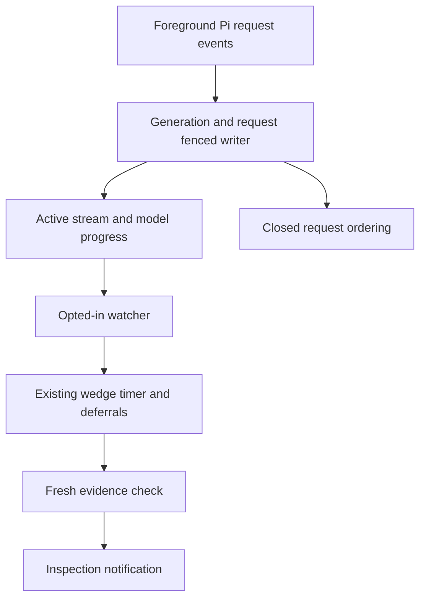
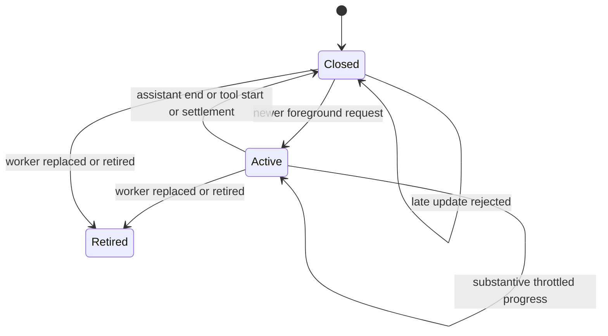

# Pi Worker Stream Silence - Plan

## Goal Capsule

- Objective: Operators who enable stream monitoring receive an actionable inspection notification when a Pi worker stops making model progress, without alarming on ordinary silent tools.
- Means: Foreground Pi lifecycle evidence and the existing busy-state writer and wedge timer.
- Authority: Issue #6881 and its maintainer triage govern product behavior; repository contribution and verification rules govern delivery.
- Execution: Implement the dependent units below and preserve the existing default behavior.
- Stop conditions: A covering PR, unavailable required verification, or an unsafe lifecycle assumption blocks publication.
- Tail ownership: Implementation returns local evidence; the outer LFG workflow owns review and no-mistakes publication.

---
## Product Contract

### Summary

Add optional phase-aware observation of Pi worker model-stream silence.
The inspection reason identifies model silence and keeps the existing escalation cadence and deferrals.

### Problem Frame

A Pi request that is accepted and stops streaming remains busy until the general one-hour bound expires.
Operators lose lane time because current evidence cannot distinguish that request from a legitimate silent build.

### Requirements

**Activation and compatibility**

- R1. `FM_STREAM_SILENT_MAX_SECS` is off when unset, empty, zero, negative, malformed, or outside the supported numeric range; a positive decimal seconds value enables stream observation.
- R2. Default-off workers, unsupported Pi versions, absent instrumentation, and other harnesses preserve their existing busy-duration bounds and native-progress behavior.
- R3. Activation is captured when the worker extension is generated and independently required by the observing watcher; changing a running watcher's setting cannot instrument an older worker.

**Lifecycle and ownership**

- R4. Only the current worker generation and current foreground request may create or refresh active stream evidence; obsolete, closed, malformed, and unarmed request events are rejected at the writer.
- R5. Substantive assistant text, thinking, or tool-call argument activity refreshes stream evidence at most once per second; empty or unchanged events and background provider traffic do not count as progress.
- R6. Assistant message completion, tool execution start, idle settlement, replacement, and retirement clear active evidence; late updates cannot recreate it.
- R7. Stream observation neither changes semantic busy state nor fabricates completed-turn notifications, and its progress-anchor extension shares R1's activation boundary.

**Inspection**

- R8. An expired current stream enters the existing inspection-only wedge cadence in both stable and changing-pane paths, with a reason naming model-stream silence and its observed duration.
- R9. Fresh progress, completion, request replacement, or invalid evidence cancels the obsolete stream escalation episode; the watcher revalidates its evidence immediately before publishing an inspection notification.
- R10. Existing declared-wait, worktree-write, dead-endpoint, escalation-count, and deep-inspection behavior remains applicable; no automatic interrupt, restart, or provider recovery is added.

### Acceptance Examples

- AE1. Covers R1-R3: With no opt-in, an ordinary Pi request produces no stream marker and the general busy bound remains unchanged.
- AE2. Covers R4-R9: A current request stops producing content before the general bound; after the configured silence threshold and wedge delay, inspection names the stalled model phase.
- AE3. Covers R6, R9-R10: A tool begins or a new request makes progress during inspection preparation; obsolete stream evidence does not produce a model-silence notification.
- AE4. Covers R4, R6: Old-generation updates and delayed updates for a closed request leave the replacement request untouched.

### Scope Boundaries

This issue covers worker stream observation and its existing inspection path.
Provider retries, automatic recovery, primary supervision instrumentation, and secondmate wake-stall redesign are excluded.
Additional vendor versions require separate real verification before entering the verified-version set.

---
## Planning Contract

### Key Technical Decisions

- KTD1. Extend `bin/fm-busy-event.sh` under its existing generation lock and state the record contract in `bin/fm-busy-lib.sh` (R4, R6-R7).
  Keep a closed-request ordering record separate from active evidence so delayed events cannot resurrect it.
- KTD2. Use Pi's foreground per-call `context` event to open tracking (R4-R6).
  Pi 1.2.0 shares provider callbacks with background cache warming, so `before_provider_request` alone cannot identify the foreground request.
  The observed interval includes foreground request preparation and authentication, which the inspection reason and documentation must make clear.
- KTD3. Serialize generated extension writes and carry increasing request identity through the writer (R4-R6).
  Compare substantive content snapshots rather than mutable object identity; close handlers reset local activity before waiting for disk writes.
- KTD4. Verify the selected executable against an explicit version set, initially Pi 1.2.0 only (R2-R3).
  Unverified versions keep legacy wiring and emit an actionable opt-in diagnostic rather than claiming stream protection.
- KTD5. Reuse the existing wedge timer and deferrals, adding a stream evidence identity that is rechecked at notification time (R8-R10).
  A timer belongs to one generation/request/activity episode; changing that identity resets it.
- KTD6. Keep normal model progress separate from the legacy native progress marker (R1-R2, R7).
  The watcher can include the opted-in model-progress anchor without a later disabled watcher inheriting a changed default anchor.

### High-Level Technical Design

### Assumptions and Risks

The opt-in controls observation rather than model timeout or recovery.
Use bounded positive decimal input validation before shell arithmetic.
Failed marker writes degrade observation and must not break Pi's own lifecycle; repeated failure is reported rather than silently credited as protection.
Revalidation proves current observation at the publication decision; it never grants authority to recover a worker.
No private home or credentials are needed: the real installed Pi can consume a synthetic local stream through its public SDK in an isolated agent directory.

---
## Implementation Units

### U1. Own foreground stream lifecycle

**Goal:** Produce ordered, generation-bound stream evidence from verified opted-in Pi workers.
**Requirements:** R1-R7, AE1, AE4.
**Dependencies:** None.
**Files:** `bin/fm-busy-lib.sh`, `bin/fm-busy-event.sh`, `bin/fm-spawn.sh`, `tests/fm-busy-state.test.sh`, `tests/fm-busy-adapter-wiring.test.sh`.
**Approach:** Extend existing mutation and generated-extension boundaries using KTD1-KTD4 and KTD6.
**Execution note:** First reproduce missing stream behavior through executable writer and generated-extension interfaces.
**Patterns:** Existing `progress`, `arm`, `retire`, generated Pi lifecycle handlers, and `drive_pi_ext`.
**Test scenarios:**

- Open a current request, refresh substantive progress, then close it without changing semantic busy state or turn notification.
- Reject unarmed and stale-generation operations, superseded request events, duplicate opening, and late closed-request updates.
- Clear active and ordering state on arm/retire while rejecting an old retirement against a new generation.
- Drive the generated extension with opt-in absent, malformed, enabled, and unsupported versions.
- Exercise empty/unchanged/text/thinking/tool-argument updates, throttling, assistant versus user/tool message end, retry reopening, and close/start ordering.

**Verification:** Focused behavior suites pass with red-before-fix evidence and no source-text assertions.

### U2. Integrate silence inspection

**Goal:** Surface expired stream evidence through existing safe inspection behavior.
**Requirements:** R8-R10, AE2-AE3.
**Dependencies:** U1.
**Files:** `bin/fm-watch.sh`, `bin/fm-busy-lib.sh`, `tests/fm-watch-triage.test.sh`.
**Approach:** Apply KTD5 to both busy-pane branches and KTD6 to opted-in age selection.
**Patterns:** `busy_turn_bound_check`, `wedge_timer_check`, existing stable/ticking busy tests.
**Execution note:** Demonstrate the accepted silent request remains hidden before the change.
**Test scenarios:**

- An expired current stream starts the wedge timer before the general bound for both stable and changing pane output.
- A below-threshold stream, disabled option, foreign harness, absent/invalid/closed/stale marker, or long silent tool starts no stream timer.
- Fresh progress, a new request, settlement, or replacement clears the old episode and suppresses a stale publication decision.
- Backdate an admitted episode and verify a specific model-silence reason, ordinary deferrals, escalation count, and demand-inspection behavior.
- Disable observation after opted-in progress and verify native/default age selection is unchanged.

**Verification:** Real watcher behavior over synthetic isolated homes passes without a live fleet or production state.

### U3. Prove real Pi and document activation

**Goal:** Verify vendor events end to end and document the supported option and limits.
**Requirements:** R1-R10.
**Dependencies:** U1, U2.
**Files:** `tests/fm-pi-worker-stream-live-e2e.test.sh`, `tests/fm-pi-worker-stream-live.mjs`, `bin/fm-test-run.sh`, `docs/configuration.md`, `docs/verification/runtime-backends.md`, `.agents/skills/harness-adapters/references/harness/pi.md`.
**Approach:** Use the real installed Pi resource loader/session/model runtime with isolated directories and a synthetic provider transport, following the existing held-stream SDK guard.
**Test scenarios:**

- Load the actual generated worker extension in Pi 1.2.0 and hold an accepted model response; observe opening and substantive updates at the real writer.
- Release assistant completion, execute an isolated harmless tool, and run a subsequent request; observe clearing and fresh identity.
- Demonstrate background provider traffic cannot open foreground evidence.
- Prove default-off behavior against the same real harness and report signed-wrapper or unavailable-version omissions honestly.

**Verification:** The live guard checks a real harness, refuses empty coverage, names its version, and shuts down all owned resources within its bound.
Maintained documentation follows the audience inventory and contains current guarantees, while task-specific evidence stays outside maintained prose.

---
## Verification Contract

Run focused suites through `bash bin/fm-test-run.sh tests/fm-busy-state.test.sh tests/fm-busy-adapter-wiring.test.sh tests/fm-watch-triage.test.sh`.
Run the new real Pi guard through `bash bin/fm-test-run.sh tests/fm-pi-worker-stream-live-e2e.test.sh` and retain exact version/output.
Run `bash bin/fm-lint.sh` and `bash bin/fm-doc-audience-check.sh` after all changes.
Run test-inventory coverage when registering the new guard.
Unavailable required tooling is a publication blocker; do not install it under this scope.
No UI changes are planned, so browser applicability is checked by the outer workflow.

---
## Definition of Done

Each unit satisfies its behavior scenarios and reports actual red/green evidence or a precise omission.
The complete diff preserves R1-R10 and contains no abandoned implementation or unrelated edits.
Independent code review and required local checks pass before no-mistakes publication.
The PR references #6881 according to the accepted final scope and retains current-head no-mistakes review/test/document attestation.
The parent receives the canonical branch, full head, PR URL, one-shot CI/review state, and any remaining blocker.

### Sources

- [Issue #6881 and maintainer triage](https://github.com/kunchenguid/firstmate/issues/6881).
- `bin/fm-busy-event.sh`, `bin/fm-busy-lib.sh`, `bin/fm-spawn.sh`, `bin/fm-watch.sh`.
- `tests/fm-pi-branch-live-e2e.test.sh` held-stream SDK integration pattern.
- Installed public Pi 1.2.0 extension declarations, SDK provider callback wiring, cache warmer, and agent-loop lifecycle implementation.
