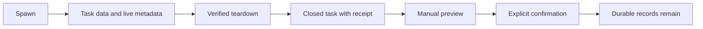

# Task data lifecycle

`data/<task-id>/` holds private task records and scratch files.
Nothing expires automatically.

Successor launches read `brief.md` and `launch-brief.md` to recover the task contract.
Scout completion reads `report.md`; backlog completion can retain its path through tasks-axi.
Status and log records preserve task outcomes after runtime state retires.
These readers require durable records after worktree teardown.

Teardown retains task data and records a pruning receipt only after existing worktree safety checks and endpoint cleanup succeed.
Forced teardown never records that receipt.
Pruning also requires an absent task metadata record and a closed, unheld backlog row.
It rejects pending backlog transitions and relaunches.
It holds the task control and metadata locks while it checks eligibility and removes files.
Old folders without a receipt remain untouched because their teardown safety cannot be proved.
Do not create receipts manually.

The manual entry point is `bin/fm-data-prune.sh`; its header and `--help` own invocation details.
It previews each eligible folder, each selected file, and their total logical bytes.
Only an explicit `--confirm` removes files.
This command requires Python 3 and compatible tasks-axi, and uses the active home's configured backlog adapter.

The file selector preserves Markdown, text, status, log, JSON, JSONL, YAML, and TOML records regardless of size.
It preserves rotated log and status files, plus files and directories named `status`, `log`, `logs`, `stdout`, or `stderr`.
It also preserves every UTF-8 text file smaller than 1 MiB that contains no NUL byte.
Other regular files are scratch candidates.
Removal requires at least 1 MiB of candidate files in the task folder, including its descendants.
Thus large scratch files and collections of small binary files can be removed without deleting small text records.
Empty directories remain.
Symlinks and special files remain untouched, and traversal never follows symlinks.
The command ignores loose `data/` files and folders without verified task completion.

`tests/fm-data-prune.test.sh` covers preview, confirmation, record preservation, and unsafe task exclusion.
`tests/fm-teardown.test.sh` covers receipt creation through the existing teardown safety checks.
