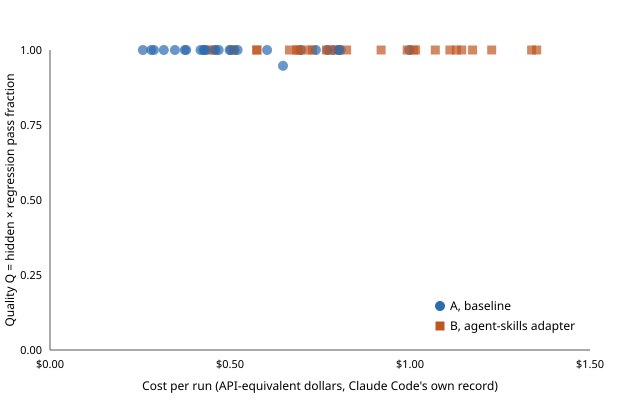
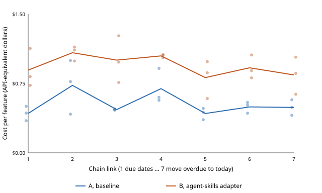

# Evidence: does the agent-skills adapter beat the baseline?

The two builds this report compares:

- Baseline, without the adapter: https://github.com/ahcarpenter/firstmate-eval-todomvc-baseline
- With Addy Osmani's agent-skills through the adapter: https://github.com/ahcarpenter/firstmate-eval-todomvc-agent-skills

The runs took place on 2026-10-30 (UTC).
Paths under `eval/` below are in both repositories.

## Summary

- **What was run.** The same autonomous worker (Claude Code, Claude Opus 5.5 at medium effort, launched the way firstmate launches its workers) carried out nine tasks on a small Next.js TodoMVC app, three times each, with and without firstmate's adapter for [addyosmani/agent-skills](https://github.com/addyosmani/agent-skills) 0.6.14.
  A seven-link chain of dependent features and a future-change probe for every run followed: 132 runs in all.
  Hidden acceptance tests the workers never saw graded every result, and a blind reviewer from another model family, calibrated against the author, scored the paired runs.
- **Quality: the same.** Both arms reached the ceiling.
  Mean quality was 0.998 without the pack and 1.000 with it (26 and 27 full successes of 27); the difference is not significant (p = 1.0).
- **Maintainability: the same.** Neither arm broke any earlier feature across the seven-link chain, every follow-up change passed on both arms' code, the next change cost the same on either arm's code, and complexity, duplication, lint, type escapes, and test coverage are indistinguishable.
- **Cost: higher with the pack.** The adapter costs 1.61 times as much per task (higher on all nine, significant), 1.80 times per feature along the chain, and 1.32 times as much to own once the next change is counted, using about twice the tokens and 1.9 times the time.
- **The pack was followed.** Adapter-arm runs reviewed their own change and checked that their tests can fail far more often than the baseline, and kept to scope slightly more often (27 against 24 of 27); the extra care changed how the work was done, not what it delivered.
- **Verdict.** By the bar written before the first run, the adapter does not beat the baseline, and the setup without the pack is recommended: it is simpler and cheaper.
  These tasks were easy enough that both arms succeeded almost every time, so this rules out a benefit at this difficulty, not on harder work; a more complex evaluation and a week of real use on real work follow.

## What this measures

The [RFC](https://github.com/kunchenguid/firstmate/pull/7980) proposes a `best-practices=<owner>/<repo>` registry token whose adapter adds a pack's engineering practice to firstmate's worker brief, starting with [addyosmani/agent-skills](https://github.com/addyosmani/agent-skills) 0.6.14.
Being wired correctly is not the bar: a plausible practice can make an agent worse.
This evaluation runs the same tasks with and without the adapter and compares success, rework, time, tokens, and what a team gets from the result, then applies a verdict rule written down before the first paid run.
On the author's word, the bar was amended once while the first runs were under way and before anything was graded, then frozen: cheap passes that leave harder-to-change code must not rate well, so a seven-link dependent chain, a future-change probe for every run, maintainability measures, and a test-value measure were added, and the blind reviewer was calibrated against the author.

## Method

### Fixture

A small Next.js 16 (App Router, TypeScript) implementation of the [TodoMVC spec](https://github.com/tastejs/todomvc/blob/master/app-spec.md): add, toggle, toggle all, edit on double-click (Enter and blur save, Escape cancels, empty deletes), delete, filters at `/`, `/active`, and `/completed`, clear completed, the item counter, and `localStorage` persistence, styled with the official `todomvc-app-css`.
It ships its own checks the way a real project would: ESLint, `tsc`, a Vitest unit suite (7 tests), a Playwright smoke test, and a README naming them.
It carries one seeded bug, the kind a real codebase has: new ids are `todos.length + 1`, so after a delete a new todo can share an id with an existing one.
Both arm repositories start from the same two fixture commits.

### Tasks

Nine tasks, each written as an owner would ask for it (`eval/tasks/`):

| Task | Kind | Level | Ask, in short |
| --- | --- | --- | --- |
| `fix-duplicate-ids` | bug fix | spec-shaped | Checking one todo sometimes checks another, after a delete. |
| `refactor-state` | refactor | spec-shaped | Split state out of `TodoApp.tsx` so it can be unit tested; no behavior change. |
| `a11y-keyboard` | accessibility | spec-shaped | Make toggle, edit, and delete work by keyboard and announce properly. |
| `completed-count` | underspecified | spec-shaped | "Show how many todos they've completed." |
| `dedupe-active` | feature | past the spec, easy | Don't add a todo that is already on the list and not done; say so. |
| `undo-delete` | feature | past the spec, medium | Give a few seconds to undo a delete. |
| `due-dates` | feature, chain 1 of 2 | past the spec, medium | An optional due date when adding, shown as "Due Nov 3". |
| `overdue` | feature, chain 2 of 2 | past the spec, medium | Overdue marking, an `/overdue` filter, and a footer count, built on the same run's due dates. |
| `multiple-lists` | feature with a data migration | past the spec, hard | Named lists with their own URLs; existing todos become a list called "Todos". |

TodoMVC is in every model's training data, so five of the nine go past the spec, at three difficulty levels.
Each task has a canned answer, fixed in advance, given only if the worker stops to ask.

### Arms

The two arms differ only in the adapter:

- **A, baseline**: the local-only ship brief `bin/fm-brief.sh` composes at the firstmate commit under test ([`29abcc73`](https://github.com/ahcarpenter/firstmate/tree/best-practices-eval-tested), the adapter's implementation rebased onto `main` at `b936f040`), without `--best-practices`.
- **B, adapter**: the same brief with `--best-practices addyosmani/agent-skills`, which appends the adapter's practice section (its static full table), the pack's 0.6.14 release loaded into the session, and the spawn's two exports, `FM_BEST_PRACTICES=addyosmani/agent-skills` and `FM_BEST_PRACTICES_VERSION=0.6.14`.

The `--best-practices` option and `bin/fm-best-practices.sh` cited in this report live at the `best-practices-eval-tested` tag, which points to `29abcc73`, and in [#7981](https://github.com/kunchenguid/firstmate/pull/7981), not on `main`.

The pack copy's 22 depended-on `SKILL.md` files hash to exactly the adapter's recorded 0.6.14 fingerprints (`bin/fm-best-practices.sh fingerprints --source 0.6.14=<copy>` output identical to the manifest's), so arm B runs the reviewed text.

Everything else is identical and fixed: Claude Code 2.1.312 headless (`claude -p`, the same version for every run), model `claude-opus-5-5`, effort `medium` (firstmate's default crew profile), permissions bypassed as firstmate's workers run, user-level settings, MCP servers, and plugins excluded (`--setting-sources project,local --strict-mcp-config`) in a clean process environment, the launch path firstmate's spawn uses (its worker role contract plus the launch-brief record and doorbell), the same task text and canned answers, at most two steers, and per-segment limits of 60 minutes and 25 API-equivalent dollars.
A no-cost probe of each configuration (`/context`, which runs locally) confirmed what loads: arm A only Claude Code's built-in plugins and skills, arm B those plus the pack's 25 skills, 9 commands, and 4 agents at version 0.6.14.
Each run gets a fresh copy holding only its base commit and no remote; its result is fetched back into that arm's repository as a branch named by task and repetition.

### The long chain

`due-dates` then `overdue` grows into a seven-link chain per arm and repetition: `edit-due-date` (change a todo's date while editing it), `sort-by-due` (a "Sort by date" checkbox), `due-soon` ("Due today" and "Due tomorrow"), `search` (a "Search" field), and `reschedule-overdue` (a "Move overdue to today" button).
Each link starts from the same arm and repetition's previous result and runs with its own arm's brief, like a team adding one feature after another to the same branch.
Each link is graded against its own hidden tests, every earlier link's hidden tests, and the TodoMVC regression suite, so the chain shows, per arm, what each further feature costs and how much earlier behavior it breaks.

### Future-change probes

Every other task has one follow-up change with its own hidden tests, for example a "Duplicate" button after the duplicate-id fix, pinning after the state refactor, an "Important" toggle after the accessibility work, and renaming and deleting lists after multiple lists.
A neutral worker (the baseline brief, no pack, same model and effort) applies the follow-up to each run's result, so the probe measures the code each arm left behind, not its practices.
From the probe come the follow-up's quality, how many of the run's lines it had to rewrite, and the cost of ownership (the run's cost plus its follow-up's).

### Grading

The runs never see the grader.
After all runs finish, each committed result is exported into a fresh directory and graded: the project's own lint, typecheck, unit tests, and build, then a 19-test TodoMVC regression suite and the task's hidden end-to-end acceptance tests (Playwright, 2 to 8 per task), run against the production build.
Hidden tests check behavior as a person would, not markup a task did not ask for: an accessibility test, for example, accepts any keyboard path into edit mode (a focusable title, F2, or an Edit button).
Some tests are edge cases (a different letter case for duplicates, a date field that clears after adding) that are reported separately and kept out of the score.

The grader was proven before any run, against the untouched fixture and two reference implementations written only to check it:

| Spec | Untouched fixture | Reference |
| --- | --- | --- |
| Regression suite | 19 of 19 | 19 of 19 (both references) |
| `fix-duplicate-ids` | 0 of 5 | 5 of 5 |
| `refactor-state` | 2 of 2 (no behavior may change) | 2 of 2 |
| `a11y-keyboard` | 0 of 8 | 8 of 8 |
| `completed-count` | 0 of 4, edge 0 of 1 | 4 of 4, edge 1 of 1 |
| `dedupe-active` | 1 of 5 (re-adding a completed todo already works), edge 0 of 1 | 5 of 5, edge 1 of 1 |
| `undo-delete` | 0 of 5, edge 0 of 1 | 5 of 5, edge 1 of 1 |
| `due-dates` | 1 of 5 (a dateless todo shows no date), edge 0 of 1 | 5 of 5, edge 0 of 1 (the reference keeps the date field filled) |
| `overdue` | 0 of 6, edge 0 of 1 | 6 of 6, edge 1 of 1 |
| `multiple-lists` | 0 of 7, edge 1 of 1 | 7 of 7, edge 1 of 1 |

Checking the grader this way found and fixed six test defects before any run: seed data that missed the seeded bug, two count checks that failed when adjacent inline elements ran together in the page text, a due-date test that assumed the date field clears, and two checks that read the list before a navigation settled.
It also showed the accessibility tests catch a real trap: a delete button kept `display: none` until hover cannot take keyboard focus and is absent from the accessibility tree, so "show it on `:focus`" alone fails.

After the runs, four more defective tests were found and fixed under the bar's fix-once rule, with every result of both arms re-graded; they are listed under Results with the scores before and after.

### Measures

Per run:

- Hidden fraction `h` and regression fraction `g`; quality `Q = h × g`, and `Q = 0` for a run that commits nothing.
- Full success: every hidden and regression test passes, the project's own checks pass, the change is committed, and the run ended with its done line.
- Edge cases handled, reported beside `Q`.
- Rework: steers (canned answers and nudges), turns, and failed check commands the worker ran.
- Time: launch to the last session's end.
- Tokens and cost: Claude Code's own per-session record (input, cache write, cache read, output, and its API-equivalent cost).

Added by the amendment (all defined before grading in `eval/BAR.md`):

- Chain quality per link `CQ = Q × R`, where `R` is the share of earlier tests (earlier links' hidden tests and the regression suite) still passing; cost per feature along the chain.
- Follow-up quality `Q_f`, maintainability-adjusted quality `MQ = Q × Q_f`, cost of ownership `C_own`, and the rewrite fraction.
- Maintainability per run: added complexity (ESLint `complexity`), duplication (jscpd), lint warnings, type escape hatches (`any`, `@ts-ignore`, and the like), and the unit-test coverage of the changed lines; a ninth rubric criterion, `maintainability`.
- Test value: when a later change breaks earlier behavior that the hidden tests check, whether the earlier work's own tests also catch it.
  Writing tests does not count as good by itself.
- Practice application, a diagnostic outside every rule: whether each run actually applied the practices in the brief and the adapter's section (reproduce first, run the repository's checks before done, record assumptions on an underspecified ask, review and simplify, update docs, keep scope), scored mechanically from the tool-call order where it shows and otherwise by the blind reviewer from redacted step summaries.
  It doubles as a manipulation check on whether the pack was followed at all.
- Reviewer calibration: the author scores six runs blind with the same rubric; a criterion where the author and Codex differ by a point or more on average (0.75 or more on the overall score) is rewritten and every run re-scored before any reviewer number is read.

What a team gets, beside the per-run numbers:

- Building on each other's work: the seven-link chain, each link starting from the same arm and repetition's previous result (repetition 1's chain lands on each repository's `main`), and the future-change probes.
  The cost and regressions along them show what the next contributor's change costs on top of each arm's code.
- Consistency: per task and arm, how alike the three repetitions are (files touched, diff size spread, whether tests were written, Conventional Commit adherence).
- Reviewability: a blind review by a different model family (Codex), scoring each run's commits, diff, done summary, and status lines against a fixed rubric of nine criteria (change size, summary clarity, verification story, follow-ups, decision records, handoff, code quality, tests, and, from the amendment, maintainability) and an overall score.
  The pack's name, its skills, its version, and its tells are redacted from the packet first.
- Handoff: the reviewer's handoff score, and the chain links and follow-up probes, which are real handoffs to another agent.
- Alignment: per task, the two arms' results side by side: behavior covered, edge cases handled, tests and docs written, and what one arm did that the other did not.

### The bar

Written and committed before the first paid run, amended once before any grading, and quoted unchanged at the end of this report.
In short: the primary outcome is the per-task difference in mean `Q`, tested with an exact two-sided paired sign-flip permutation test over the nine tasks at 0.05, with the exact Wilcoxon signed-rank test beside it; review score, regression failures, and cost are secondary, Holm-corrected; the adapter wins only on a significant quality gain, or on a significant secondary benefit with quality held, and otherwise the setup without the pack is recommended because it is simpler and cheaper; fewer than eight tasks with two runs per arm is reported as too small, not as a pass.

## Run plan

132 Claude runs: the 54 paired runs (9 tasks, 2 arms, 3 repetitions), pair by pair in the seeded random order (`eval/harness/plan.tsv`), the two arms of each pair back to back in a seeded random arm order; then the chain's 30 later-link runs (`chain-plan.tsv`); then 48 future-change probes (`probe-plan.tsv`).
Then grading, then the blind Codex reviews: the rubric review and the practice review of each paired run, and, exploratory, the re-score under rubric revision 2.
An interrupted run is set aside unscored and re-run from its base; only the completed run is scored.

## Deviations from the plan as briefed, and why

- Runs execute one at a time, the two arms of a pair back to back, rather than both arms at once: the app's dev and end-to-end test servers use fixed ports, so concurrent runs could reach each other's app.
  The arm that goes first in each pair is a seeded coin flip, so time of day, cache, and rate limits still fall on both arms alike.
- The six reviewer-calibration runs were graded and reviewed early, while later paired runs were still under way, so the author could score them sooner.
- The pack is loaded into each arm B session from a fingerprint-verified copy of the 0.6.14 release (`--plugin-dir`) rather than installed at project scope in each copy; the session sees the same pack text either way, as the configuration probe above confirms.
- Arm B's practice section is the adapter's static full table, which is what `bin/fm-brief.sh` writes; routing through Jev would narrow it per task but needs a network key and sends brief text to an external service, so it is out of this evaluation.
- Delivery is local-only, so the adapter's `doubt-driven-development` cycle, which it adds only on no-mistakes projects, is not exercised, and nothing here measures a pipeline's review rounds.
- User-level instructions are excluded from both arms, so the baseline is firstmate's brief alone, not a user's personal setup.

## Results

All 132 runs finished with a committed change and a done line: 54 paired runs, 30 later chain links, and 48 future-change probes.
No run was interrupted and none had to be re-run.
Only one paired run stopped to ask a question (a baseline `refactor-state` run, which got the canned answer); no run in either arm asked about the underspecified `completed-count` ask.

### The primary outcome and the secondary outcomes (the bar as first written)

| Measure | A, baseline | B, adapter | Per-task difference, B − A | Exact sign-flip p | Holm p |
| --- | ---: | ---: | ---: | ---: | ---: |
| Quality `Q` (primary) | 0.998 | 1.000 | +0.002 (1 task higher, 8 tied) | 1.000 (Wilcoxon 1.000) | - |
| Full successes | 26 of 27 | 27 of 27 | | | |
| Blind review, overall (rubric revision 1, of record) | 3.85 | 3.63 | −0.22 (2 tasks higher, 5 lower) | 0.219 | 0.438 |
| Regression failures per run (lower is better) | 0.04 | 0.00 | 0.04 fewer for B (1 task) | 1.000 | 1.000 |
| Cost per run, API-equivalent dollars | 0.54 | 0.87 | ×1.61 (higher on all 9 tasks) | 0.004 | **0.012** |

The one baseline run short of full success is a `multiple-lists` run that lost the new-todo field's focus on page load (`Q` 0.95); every other run in both arms passed every hidden and regression test and the project's own checks.

Variance and cost, per run:

| | A, baseline | B, adapter | B ÷ A |
| --- | --- | --- | ---: |
| Cost, dollars: mean (SD; range) | 0.54 (0.20; 0.26 to 1.00) | 0.87 (0.27; 0.45 to 1.35) | 1.61 |
| Tokens, all kinds: mean | 471 thousand | 975 thousand | 2.07 |
| Output tokens: mean | 10 thousand | 14 thousand | 1.40 |
| Wall time, seconds: mean (SD) | 155 (95) | 288 (181) | 1.86 |
| Turns: mean (SD) | 14.3 (6.1) | 22.9 (6.9) | 1.60 |
| Failed check commands the worker ran, all runs | 1 | 9 | |
| Files touched / lines changed: mean | 5.8 / 155 | 5.7 / 150 | |

Per task (means over the three repetitions; `Q`, cost in dollars, wall time in seconds, turns, blind review overall under revision 1):

| Task | `Q` A / B | Cost A / B | Time A / B | Turns A / B | Review A / B |
| --- | --- | --- | --- | --- | --- |
| `fix-duplicate-ids` | 1.00 / 1.00 | 0.36 / 0.51 | 88 / 114 | 11 / 13 | 4.00 / 3.67 |
| `refactor-state` | 1.00 / 1.00 | 0.60 / 0.72 | 144 / 338 | 13 / 18 | 4.00 / 4.00 |
| `a11y-keyboard` | 1.00 / 1.00 | 0.71 / 1.00 | 227 / 505 | 16 / 23 | 3.33 / 3.67 |
| `completed-count` | 1.00 / 1.00 | 0.55 / 0.72 | 130 / 214 | 20 / 23 | 4.33 / 3.67 |
| `dedupe-active` | 1.00 / 1.00 | 0.33 / 0.60 | 62 / 125 | 10 / 16 | 4.67 / 4.00 |
| `undo-delete` | 1.00 / 1.00 | 0.46 / 0.98 | 142 / 361 | 11 / 26 | 3.00 / 3.33 |
| `multiple-lists` | 0.98 / 1.00 | 0.69 / 1.29 | 165 / 290 | 16 / 31 | 3.67 / 3.00 |
| `due-dates` | 1.00 / 1.00 | 0.43 / 0.89 | 100 / 208 | 11 / 26 | 3.67 / 3.33 |
| `overdue` | 1.00 / 1.00 | 0.73 / 1.08 | 335 / 441 | 21 / 30 | 4.00 / 4.00 |

### The long chain: building on each other's work

| Link | Feature | `CQ` A / B | Cost per feature A / B | Time A / B | Turns A / B |
| ---: | --- | --- | --- | --- | --- |
| 1 | due dates | 1.00 / 1.00 | 0.43 / 0.89 | 100 / 208 | 11 / 26 |
| 2 | overdue | 1.00 / 1.00 | 0.73 / 1.08 | 335 / 441 | 21 / 30 |
| 3 | change a date while editing | 1.00 / 1.00 | 0.47 / 1.00 | 89 / 346 | 13 / 27 |
| 4 | sort by date | 1.00 / 1.00 | 0.69 / 1.05 | 168 / 322 | 20 / 31 |
| 5 | "Due today" and "Due tomorrow" | 1.00 / 1.00 | 0.43 / 0.81 | 74 / 168 | 10 / 22 |
| 6 | search | 1.00 / 1.00 | 0.50 / 0.92 | 111 / 200 | 13 / 26 |
| 7 | move overdue to today | 1.00 / 1.00 | 0.49 / 0.84 | 83 / 190 | 14 / 24 |

- Every link in both arms passed its own hidden tests, and no link broke any earlier link's hidden tests or the regression suite: the regression rate is 0 at every link, so chain quality `CQ` is 1.00 throughout and the per-link difference is exactly 0 (p = 1.000).
- The adapter arm paid more for every feature: ×1.80 per feature (higher on all 7 links; exact sign-flip p = 0.016, Holm p = **0.047**), and the whole seven-feature chain cost 3.67 to 3.80 dollars per repetition in the baseline against 6.33 to 6.77 with the adapter.
- Cost did not climb along the chain in either arm: on this app, the code each arm left did not make later features dearer.

### Future-change probes: the code each arm left behind

A neutral worker (the baseline brief, no pack) applied one follow-up change to every run's result.

| | Probes on A's code | Probes on B's code |
| --- | --- | --- |
| Follow-up hidden tests passed (`h_f`) | 24 of 24 probes, every test | 24 of 24 probes, every test |
| Earlier behavior kept (`g_f`) | 1.00 | 1.00 |
| Lines of the run the follow-up rewrote | 2.8% | 3.0% |
| Follow-up cost, mean | 0.50 dollars | 0.49 dollars (×0.97; p = 0.64, exploratory) |
| Follow-up time / turns, mean | 101 s / 13.2 | 109 s / 12.0 |
| Maintainability-adjusted quality `MQ` | 0.998 | 1.000 (difference +0.002, p = 1.000) |
| Cost of ownership `C_own` (run plus follow-up) | 1.06 dollars | 1.42 dollars (×1.32 per task, higher on all 9; Holm p = **0.016**) |

The next change costs the same on either arm's code and rewrites as little of it; the adapter's higher cost of ownership is entirely its own runs' cost.

The four amendment tests, Holm-corrected together:

| Amendment outcome | Mean difference | Exact sign-flip p | Holm p |
| --- | ---: | ---: | ---: |
| Chain `CQ` (7 links) | 0.000 | 1.000 | 1.000 |
| Chain cost per feature, log B/A | +0.588 (×1.80) | 0.016 | 0.047 |
| `MQ` (9 tasks) | +0.002 | 1.000 | 1.000 |
| Cost of ownership, log B/A | +0.280 (×1.32) | 0.004 | 0.016 |

### Maintainability, per run (descriptive)

| Measure (mean per paired run) | A, baseline | B, adapter |
| --- | ---: | ---: |
| Added complexity (sum of ESLint `complexity`) | +11.3 | +11.2 |
| Duplicated-line percentage added (jscpd) | +0.04 | +0.04 |
| Lint warnings added | 0 | 0 |
| Type escape hatches added (`any`, `@ts-ignore`, and the like) | 0.15 | 0.11 |
| Unit-test coverage of the changed source lines | 32% | 30% |
| Unit tests added | 4.1 | 4.2 |
| End-to-end tests added | 1.9 | 2.3 |
| Source lines added | 76 | 70 |

The two arms' code is indistinguishable on every maintainability measure.

### Test value

A regression counts when a hidden or regression test that passed on an earlier result fails on a later one, in the chain or after a probe.
Across all 84 such checks (36 chain links, 48 probes), none was flagged in either arm, so there was no regression for the earlier work's own tests to catch, and the test-value measure cannot separate the arms here.
Both arms wrote tests on every run (3 of 3 per task in both arms); by the bar's rule that counts for nothing on its own.

### What a team gets

- **Building on each other's work.** Equal: seven features in a row with no regression in either arm, and the next contributor's change costs the same on either arm's code.
  The adapter's own chain links cost 1.8 times as much.
- **Consistency across repetitions.** Similar, the adapter arm slightly more uniform: files-touched overlap between repetitions averages 0.67 (baseline) and 0.73 (adapter), and the spread of diff sizes (coefficient of variation) 0.14 and 0.10.
  Every run in both arms wrote tests and used Conventional Commit subjects.
- **Reviewability.** No significant difference on the overall score under either rubric version (revision 1: 3.85 against 3.63, p = 0.22; revision 2: 3.81 against 3.93, p = 0.72).
  The per-criterion picture depends on the rubric; see the exploratory section below.
- **Handoff.** The real handoffs, the chain and the probes, show no difference in what the next worker achieved or paid.
  The reviewer's handoff score is lower for the adapter arm under revision 1 (3.44 against 2.81) and slightly higher under revision 2 (4.07 against 4.22), which tracks the redaction effect described below rather than the code.

### Alignment: what each arm produced, task by task

Sums over the three repetitions of each task; the edge column counts `@edge` tests passed.

| Task | Edge cases A / B | Source lines added A / B | Unit tests added A / B | End-to-end tests added A / B | README updated A / B |
| --- | --- | --- | --- | --- | --- |
| `fix-duplicate-ids` | - | 50 / 45 | 9 / 9 | 2 / 5 | 0 / 0 of 3 |
| `refactor-state` | - | 239 / 213 | 29 / 28 | 0 / 0 | 3 / 3 |
| `a11y-keyboard` | - | 343 / 219 | 0 / 0 | 17 / 18 | 1 / 1 |
| `completed-count` | 3 / 3 of 3 | 50 / 18 | 0 / 0 | 3 / 3 | 0 / 0 |
| `dedupe-active` | 3 / 3 | 98 / 69 | 12 / 12 | 4 / 6 | 0 / 2 |
| `undo-delete` | 3 / 3 | 282 / 320 | 14 / 16 | 10 / 13 | 2 / 3 |
| `multiple-lists` | 3 / 3 | 587 / 607 | 26 / 25 | 10 / 11 | 3 / 3 |
| `due-dates` | 3 / 3 | 213 / 194 | 7 / 6 | 3 / 3 | 1 / 0 |
| `overdue` | 3 / 3 | 197 / 215 | 15 / 18 | 3 / 3 | 3 / 3 |

Behavior covered is the same: both arms passed every hidden test of every task (the one baseline shortfall is a regression, not a missed behavior) and every edge case.
Where the arms differ, the differences are small and run both ways: the adapter arm wrote somewhat more end-to-end tests (62 against 52), touched the README on 2 more `dedupe-active` and 1 more `undo-delete` run and 1 fewer `due-dates` run, and wrote leaner accessibility and completed-count changes; the baseline wrote leaner `undo-delete` and `overdue` changes.
**How closely the no-adapter result matches the adapter result:** on every outcome measured here, as closely as repetitions of the same arm match each other.
Nothing the adapter arm delivered is missing from the baseline's results.

### Did the adapter's practices take hold? (practice-application diagnostic, outside every rule)

Scored per run from the transcript: mechanically where the tool-call order shows it, otherwise by the blind reviewer from redacted step summaries.
Counts are runs where the practice was applied, out of 27 per arm, with partly applied in brackets.

| Practice | A, baseline | B, adapter |
| --- | --- | --- |
| Reviewed its own change before done | 2 (4) | 24 (3) |
| Checked its tests can fail (broke the change on purpose, or saw a new test fail first) | 10 (3) | 27 (0) |
| Built in small, checked steps | 2 (15) | 10 (16) |
| Kept to the ask, listing unrelated problems instead of fixing them | 24 (2) | 27 (0) |
| Said which checks ran and what was checked by hand | 13 (14) | 21 (6) |
| Exercised the change in a browser or end-to-end test before done | 19 (1) | 26 (1) |
| Found the project's own check commands first | 18 (5) | 20 (6) |
| Reproduced the bug before fixing it (where the reviewer judged it applicable) | 0 of 6 | 8 of 12 (2) |
| Updated docs where behavior changed (where applicable) | 12 of 12 | 13 of 14 (1) |
| A behavior-preserving simplification pass after the checks passed | 0 (0) | 1 (3) |
| Recorded assumptions on the underspecified ask (where applicable) | 0 of 5 (4) | 0 of 6 (3) |
| Ran lint, typecheck, unit tests, and build after the last code edit (mechanical) | 3 (23) | 12 (13) |

The manipulation check passes: arm B did follow the pack's practices, much more often than the baseline, mostly from the brief's practice section (the pack's skills were loaded explicitly in 8 of 27 arm B runs).
So the result below is not a null from a pack that was ignored: the practices were applied, and on these tasks they changed how the work was done without changing what it delivered.

### The grader fixes after the runs

Under the bar's fix-once rule, four defective hidden tests were fixed after every run had finished and before any arm comparison was read, and every result of both arms was re-graded (`eval/grader/FIXES.md`):

1. The shared todo finder rejected a title followed straight by a capitalized element, so on implementations that render the due date right after the title ("Pay rentDue Nov 3") every due-date, overdue, and later chain test failed: five of six results in each date task, in both arms.
2. The search test typed into the search field before the Active view had replaced the list.
3. The multiple-lists test required `/` to redirect to `/lists/<id>`, which the ask ("`/` opens the first list") does not.
4. The counter test rejected text after the count ("0 items left · 2 completed").

The fixed grader passes the previously failing results whose behavior was right, still passes those that passed before, and still fails the untouched app exactly as before the runs.
Both scores:

| | Mean `Q`, A | Mean `Q`, B | Per-task B − A | Exact sign-flip p |
| --- | ---: | ---: | ---: | ---: |
| Before the fixes | 0.852 | 0.787 | −0.065 | 0.500 |
| After the fixes (reported above) | 0.998 | 1.000 | +0.002 | 1.000 |

Neither difference is significant; the fixes lift both arms to the ceiling.

### Exploratory: the blind review under rubric revision 2

Revision 2 rewrites the follow-ups, verification, and overall criteria from the author's calibration notes and tells the reviewer to ignore `[redacted]` markers (see the calibration section).
On the author's word every paired run was re-scored with it; revision 1 stays the rubric of record, so this has no effect on the verdict.

| Criterion | Revision 1: A / B, B − A (p) | Revision 2: A / B, B − A (p) |
| --- | --- | --- |
| Change size | 4.70 / 4.85, +0.15 (0.31) | 4.63 / 4.89, +0.26 (0.25) |
| Summary clarity | 4.37 / 3.74, −0.63 (0.03) | 4.81 / 4.70, −0.11 (0.53) |
| Verification story | 4.44 / 4.37, −0.07 (0.86) | 4.70 / 5.00, +0.30 (0.06) |
| Follow-ups | 4.19 / 3.48, −0.70 (0.03) | 4.41 / 4.33, −0.07 (0.84) |
| Decision records | 4.19 / 4.11, −0.07 (0.83) | 4.26 / 4.48, +0.22 (0.16) |
| Handoff | 3.44 / 2.81, −0.63 (0.03) | 4.07 / 4.22, +0.15 (0.52) |
| Code quality | 3.96 / 4.07, +0.11 (0.56) | 3.78 / 4.11, +0.33 (0.06) |
| Tests | 4.63 / 4.63, 0.00 (1.00) | 4.78 / 5.00, +0.22 (0.25) |
| Maintainability | 4.00 / 4.04, +0.04 (1.00) | 3.81 / 4.15, +0.33 (0.06) |
| Overall | 3.85 / 3.63, −0.22 (0.22) | 3.81 / 3.93, +0.11 (0.72) |

The p-values are uncorrected exact sign-flip tests over the nine tasks, one per criterion.
Under revision 1 the adapter arm scored lower on summary clarity, follow-ups, and handoff; the reviewer's notes put that down to "redacted" and tooling references in the done summaries, which the adapter arm carries more of because its section asks the summary to name the pack, its version, and its constraints file.
Once revision 2 tells the reviewer to ignore redaction markers, those gaps close and the adapter arm leans slightly ahead on verification, code quality, and maintainability, none significant.
Read together: the blind review cannot tell the arms apart, and its per-criterion differences follow the blinding artifact rather than the code.

### Reviewer calibration against the author

Six paired runs (three per arm, six tasks, drawn by seed) were scored blind by the author and by the Codex reviewer under each rubric version: the original, revision 1 (rewritten after the first comparison, and the rubric of record under the frozen bar), and revision 2 (exploratory, on the author's word).
The bar's materiality rule reads the mean gap: 1.0 or more on a criterion, 0.75 or more on the overall score.
Under revision 1, follow-ups (1.17), verification (1.00), and the overall score (0.83) stay past it; under revision 2 only verification (1.00) and the overall score (1.00) do.

**Exploratory, with no effect on any rule.** The rank and spread columns below were added on the author's word: whether the reviewer orders the six changes the way the author does (Spearman's ρ and Kendall's τ-b, both corrected for ties, and the number of the 15 pairs of changes it puts in the same order, a tie counting as the same only when both tie), and whether it spreads its scores at all (population standard deviation and range beside the author's).
Every calibration point is kept, including the author's deliberately low score for one change; six changes give these statistics wide uncertainty, so read them as direction, not as estimates.

| Criterion | Rubric | Mean gap | Median gap | Spearman ρ | Kendall τ-b | Pairs in the author's order | Author SD, range | Reviewer SD, range |
| --- | --- | ---: | ---: | ---: | ---: | ---: | --- | --- |
| `change_size` | Original | 0.00 | 0.0 | n/a | n/a | 15 of 15 | 0.00, 5-5 | 0.00, 5-5 |
| `change_size` | Revision 1 (of record) | 0.33 | 0.0 | n/a | n/a | 7 of 15 | 0.00, 5-5 | 0.47, 4-5 |
| `change_size` | Revision 2 | 0.17 | 0.0 | n/a | n/a | 10 of 15 | 0.00, 5-5 | 0.37, 4-5 |
| `summary_clarity` | Original | 0.67 | 0.5 | +0.14 | +0.13 | 4 of 15 | 0.69, 3-5 | 0.37, 4-5 |
| `summary_clarity` | Revision 1 (of record) | 0.83 | 1.0 | -0.22 | -0.21 | 4 of 15 | 0.69, 3-5 | 0.47, 4-5 |
| `summary_clarity` | Revision 2 | 0.83 | 1.0 | n/a | n/a | 4 of 15 | 0.69, 3-5 | 0.00, 5-5 |
| `verification_story` | Original | 0.83 | 0.5 | +0.53 | +0.49 | 7 of 15 | 1.07, 2-5 | 0.47, 4-5 |
| `verification_story` | Revision 1 (of record) | 1.00 | 1.0 | +0.00 | +0.00 | 3 of 15 | 1.07, 2-5 | 0.37, 3-4 |
| `verification_story` | Revision 2 | 1.00 | 0.5 | +0.00 | +0.00 | 3 of 15 | 1.07, 2-5 | 0.37, 4-5 |
| `follow_ups` | Original | 1.00 | 1.0 | +0.31 | +0.30 | 5 of 15 | 1.46, 1-5 | 0.37, 4-5 |
| `follow_ups` | Revision 1 (of record) | 1.17 | 1.0 | +0.72 | +0.67 | 8 of 15 | 1.46, 1-5 | 0.94, 2-5 |
| `follow_ups` | Revision 2 | 0.17 | 0.0 | +1.00 | +1.00 | 15 of 15 | 1.46, 1-5 | 1.11, 2-5 |
| `decision_records` | Original | 0.67 | 1.0 | -0.45 | -0.45 | 4 of 15 | 0.50, 4-5 | 0.37, 4-5 |
| `decision_records` | Revision 1 (of record) | 0.67 | 0.5 | -0.45 | -0.45 | 4 of 15 | 0.50, 4-5 | 0.37, 3-4 |
| `decision_records` | Revision 2 | 0.33 | 0.0 | +0.33 | +0.33 | 6 of 15 | 0.50, 4-5 | 0.50, 4-5 |
| `handoff` | Original | 0.83 | 1.0 | +0.00 | +0.00 | 4 of 15 | 0.50, 3-4 | 0.47, 4-5 |
| `handoff` | Revision 1 (of record) | 0.50 | 0.0 | +0.00 | +0.00 | 6 of 15 | 0.50, 3-4 | 0.58, 2-4 |
| `handoff` | Revision 2 | 0.67 | 1.0 | +0.74 | +0.70 | 9 of 15 | 0.50, 3-4 | 0.69, 3-5 |
| `code_quality` | Original | 0.67 | 1.0 | n/a | n/a | 7 of 15 | 0.47, 4-5 | 0.00, 4-4 |
| `code_quality` | Revision 1 (of record) | 0.83 | 1.0 | -0.32 | -0.32 | 4 of 15 | 0.47, 4-5 | 0.37, 3-4 |
| `code_quality` | Revision 2 | 0.67 | 1.0 | n/a | n/a | 7 of 15 | 0.47, 4-5 | 0.00, 4-4 |
| `tests` | Original | 0.50 | 0.5 | n/a | n/a | 6 of 15 | 0.50, 4-5 | 0.00, 5-5 |
| `tests` | Revision 1 (of record) | 0.17 | 0.0 | +0.71 | +0.71 | 10 of 15 | 0.50, 4-5 | 0.47, 4-5 |
| `tests` | Revision 2 | 0.50 | 0.5 | n/a | n/a | 6 of 15 | 0.50, 4-5 | 0.00, 5-5 |
| `maintainability` | Original | 0.67 | 1.0 | n/a | n/a | 7 of 15 | 0.47, 4-5 | 0.00, 4-4 |
| `maintainability` | Revision 1 (of record) | 0.83 | 1.0 | -0.32 | -0.32 | 4 of 15 | 0.47, 4-5 | 0.37, 3-4 |
| `maintainability` | Revision 2 | 0.67 | 1.0 | n/a | n/a | 7 of 15 | 0.47, 4-5 | 0.00, 4-4 |
| `overall` | Original | 0.83 | 1.0 | +0.14 | +0.13 | 3 of 15 | 0.94, 2-5 | 0.37, 4-5 |
| `overall` | Revision 1 (of record) | 0.83 | 1.0 | -0.10 | -0.10 | 4 of 15 | 0.94, 2-5 | 0.50, 3-4 |
| `overall` | Revision 2 | 1.00 | 1.0 | +0.44 | +0.41 | 6 of 15 | 0.94, 2-5 | 1.41, 2-5 |

What the columns show:
- The original rubric barely discriminates: on the overall score it gave every change a 4 or 5 (standard deviation 0.37) while the author ranged from 2 to 5, and it put only 3 of the 15 pairs in the author's order.
- Revision 2 orders follow-ups exactly as the author does (15 of 15 pairs) and spreads its overall scores across the author's range, with the overall ranking moving from no agreement to a modest one (ρ +0.44).
- Neither revision tracks the author on verification (ρ 0 under both, against +0.53 under the original rubric): the reviewer's verification scores hardly vary, so it cannot rank changes the way the author did.

## Verdict

**The adapter does not beat the baseline.**
Applied as written, the bar recommends the setup without the pack.

- Clause 1, a significant quality gain: not met.
  Both arms reached the quality ceiling: mean `Q` 0.998 without the pack and 1.000 with it, a per-task difference of +0.002 (exact sign-flip p = 1.000).
  The difference is not significant.
- Clause 2, a named benefit with quality held: not met.
  Quality is held, but no secondary outcome favors the adapter significantly: the review score is not significantly different (Holm p = 0.44), nor are regression failures (Holm p = 1.00).
  The one significant secondary outcome goes against it: the adapter costs 1.61 times as much per task, higher on all nine (Holm p = 0.012).
- Clause 3 therefore applies: the arms are essentially the same, and the setup without the pack is recommended because it is simpler and cheaper.
- Clause 4, too small to separate: does not apply.
  All nine tasks have three completed runs in each arm.

The amendment's maintainability reading agrees:

- The adapter is not significantly worse on chain quality or on maintainability-adjusted quality.
  Both are identical, at 1.00 and within 0.002.
- It shows no significant gain on chain quality, so there is no named benefit.
- It is significantly costlier to build each feature on (×1.80, Holm p = 0.047) and to own (×1.32, Holm p = 0.016).
- The probes and the chain agree in substance.
  Both find no difference in the code each arm leaves behind.
  The analysis flags them as disagreeing only because +0.002 and 0.000 differ in sign.

What the adapter adds that the baseline misses is process, not outcome.
Its runs reviewed their own change, checked that their tests can fail, reproduced the bug first, and ran the full set of repository checks before done, all far more often than the baseline, and kept to scope slightly more often (27 against 24 of 27).
On these tasks, that extra care neither caught nor prevented anything the hidden tests could see.
It took about 1.6 times the money, 2 times the tokens, and 1.9 times the time.

## Recommendation

- **Do not adopt the agent-skills adapter as a default for firstmate workers on this evidence.** On this kind of work it delivers the same results at about 1.6 times the cost per change, and 1.8 times per feature in a sequence of changes.
  The setup without Addy Osmani's pack is the more helpful one here: it is simpler and cheaper.
- **Keep the adapter mechanism, but gate it on evidence.** The bar did its job: a pack that changes how agents work, without changing what they deliver, did not clear it.
  The same evaluation harness can be rerun for any later pack version or pack.
- **Look for the practices' value where this app could not show it.** That means harder changes, real codebases with real regressions to catch, and work where self-review and failure-checked tests have something to find.
  A more complex evaluation and a week of real use on real work follow this evaluation.
  If the adapter is to earn a place, it has to show it there.
- **Two findings about firstmate itself, from the author's blind calibration:**
  - Done summaries in both arms expose firstmate's own mechanics, such as "the task inbox was empty throughout" and "the status file says done." The author marked that down.
    A one-line instruction in the worker brief, to keep firstmate's mechanics out of done summaries, would fix it for every worker.
  - The adapter's done-summary requirements add more of the same noise, which matches the lower summary and handoff scores it drew under rubric revision 1.
    They require naming the pack and its tag, and saying whether a constraints file exists.

## Caveats

- **Ceiling.** 53 of 54 paired runs passed every hidden and regression test, and every chain link and follow-up passed too.
  At this difficulty the evaluation cannot separate the arms on quality; it rules out an outcome benefit here, not on harder work.
  The cost differences, by contrast, are consistent across every task and link.
- **One app, one model, one harness.** Opus 5.5 at medium effort in Claude Code; the adapter supports nine harnesses, and other models may take more or less from the pack.
- **Local-only delivery.** The adapter's `doubt-driven-development` cycle, which it adds only on projects that ship through a validation pipeline, is not exercised.
- **No regressions to catch.** No later change broke an earlier test in either arm, so the test-value measure is empty.
- **The hidden tests are the evaluator's.** Four were found defective after the runs and fixed under the bar's rule, with both scores reported; a defect still undiscovered would affect both arms alike, as these four did.
- **The blind review is weak evidence.** Calibrated against the author on six changes, the rubric of record still differs from the author past the materiality rule on follow-ups (1.17), verification (1.00), and the overall score (0.83, against 0.75 for that score), and the redaction markers that hide the setup's name lowered the adapter arm's summary and handoff scores.
  Six changes give the calibration statistics wide uncertainty.
- **Redaction hides names, not style.** A reviewer may still guess the arm.
- **Scope creep can pre-empt a follow-up.** One run added undo to "Clear completed" unasked, which is that task's follow-up probe, so its probe cost little and passed; maintainability-adjusted quality and cost of ownership can flatter scope creep, while the revised follow-ups criterion counts it against the run.
- **Cost is Claude Code's own API-equivalent record**, not a bill; the token and time ratios point the same way.
- **TodoMVC can rule a bad adapter out, but it cannot by itself prove a good one.** A small, well-known app gives the practices little room to matter.
  A more complex evaluation and a week of real use on real work follow this evaluation.

## Appendix: the bar, quoted unchanged

This is `eval/BAR.md` as it stands in both repositories: the bar written before the first paid run, its one amendment written before any grading, and its dated wording note.
In it, "the owner" is this report's author.

> # The bar, written before the first paid run
>
> This file is fixed before any paid run and is quoted unchanged in the report.
> It states what is measured, how the two arms are compared, and which result counts as the adapter winning.
>
> ## Question
>
> Does firstmate's adapter for Addy Osmani's agent-skills (`best-practices=addyosmani/agent-skills`, pack 0.6.14) make an autonomous worker's results better than the same worker without it, on real tasks against a small Next.js TodoMVC app?
>
> ## Arms
>
> - Arm A, the baseline: the local-only ship brief that `bin/fm-brief.sh` composes at the firstmate commit under test, without `--best-practices`.
> - Arm B, the adapter: the same brief with `--best-practices addyosmani/agent-skills`, the pack's 0.6.14 release loaded into the session (its content matched against the adapter's recorded fingerprints before the runs), and the two exports the spawn writes, `FM_BEST_PRACTICES=addyosmani/agent-skills` and `FM_BEST_PRACTICES_VERSION=0.6.14`.
> - Identical in both: Claude Code headless (`-p`), model `claude-opus-5-5`, effort `medium`, permissions bypassed as firstmate's workers run, user-level settings, MCP servers, and plugins excluded, a clean process environment, the same fixture commit, the same task text, the same launch path (the spawn's worker role contract and launch-brief record), the same canned answers, at most two steers, a 60-minute limit and a 25-dollar API-equivalent cap per session segment.
> - Each run gets a fresh copy holding only its base commit and no remote.
>
> ## Tasks and runs
>
> Nine tasks, in `tasks/`: four in the TodoMVC spec's own territory (a seeded bug fix, a refactor, an accessibility change, and one underspecified ask) and five past the spec at three difficulty levels (easy: duplicate guard; medium: undo delete, due dates, overdue; hard: multiple lists with a data migration).
> Due dates then overdue is a dependent chain: the overdue run starts from the same arm and repetition's due-dates result.
> Each task runs three times per arm: 54 runs.
> The order is `harness/plan.tsv`, generated by `harness/plan.py` with seed 20261029: pairs in random order, each chain's first task before its second, and the two arms of a pair started together, in random order, five seconds apart.
> A canned answer per task (`## Answer if asked`) is the only reply to a `needs-decision` or `blocked` line; a run that stops without a done line gets one fixed nudge; either counts as a steer.
>
> ## Grading
>
> Runs never see the grader.
> After all runs finish, each committed result is exported into a fresh directory and graded by `grader/grade.sh`: the project's own lint, typecheck, unit tests, and build, then the TodoMVC regression suite (`grader/regression.spec.ts`, 19 tests) and the task's hidden acceptance tests (`grader/tasks/<task>.spec.ts`) against the production build.
> Tests whose title carries `@edge` are reported as edge cases and are not in the score.
> The grader was checked before any run: the hidden tests fail on the untouched fixture and pass on reference implementations, except `@edge` tests the references deliberately skip.
> If a hidden test is found defective after the runs, it is fixed once, every run of both arms is re-graded with the fixed test, and the report lists the change with both scores.
>
> ## Per-run measures
>
> - Hidden fraction `h`: hidden acceptance tests passed over hidden tests.
> - Regression fraction `g`: regression tests passed over 19.
> - Quality `Q = h × g`. A run that commits no change scores `Q = 0`.
> - Full success: `h = 1`, `g = 1`, lint, typecheck, unit tests, and build all pass, the change is committed, and the run ended with its done line.
> - Edge cases handled: `@edge` tests passed over `@edge` tests.
> - Cost: the sessions' API-equivalent cost as Claude Code reports it (`total_cost_usd`), tokens by kind (input, cache write, cache read, output), wall time from launch to the last segment's end, turns, steers, and failed check commands.
> - Reviewability: a blind review by a different model family, Codex, scoring each run's commits, diff, done summary, and status lines against `review/rubric.md` (eight criteria and an overall score, 1 to 5), with names of the pack, its skills, its version, and its tells removed by `review/redact.py`.
> - Consistency within an arm, per task: overlap of the files touched across repetitions, the spread of diff sizes, agreement on whether tests were written, and Conventional Commit adherence.
>
> ## Comparison
>
> - Primary outcome: for each task `t`, `d_t` is arm B's mean `Q` minus arm A's mean `Q` over the repetitions.
> - Primary test: the exact two-sided paired sign-flip permutation test on the nine `d_t` (all 512 sign assignments, statistic the mean of `d_t`), significance threshold 0.05. The exact Wilcoxon signed-rank test on the same `d_t` is reported beside it.
> - Secondary outcomes, tested the same way per task and Holm-corrected together at 0.05: the blind reviewer's overall score, regression failures per run, and cost per run (log of the B to A ratio of per-task mean cost).
> - The chain's second task is also reported on its own, descriptively: what the next contributor's change cost and broke in each arm.
> - Every difference is reported with its sign, size, and p-value; a result that is not significant is called not significant.
>
> ## What counts as the adapter winning
>
> 1. The adapter wins on outcomes when the mean `d_t` is above zero and the primary test's p-value is below 0.05.
> 2. Otherwise, the adapter adds something named when its mean `Q` is no more than 0.05 below the baseline's and at least one secondary outcome favors it significantly after Holm correction (a higher review score or fewer regression failures). It is then recommended only for that named benefit, with its cost stated.
> 3. Otherwise the setup without the pack is recommended, because it is simpler and cheaper. That covers the arms being essentially the same, the baseline covering everything the adapter arm did and more, and the baseline being significantly better. Equal is a loss for the adapter.
> 4. If fewer than eight of the nine tasks have at least two completed runs in each arm, the evaluation is reported as too small to separate the arms, and not as a pass for either.
>
> ## Amendment 1, 2026-10-30, written before any result was graded; the bar is frozen after it
>
> Added on the owner's word while the paired runs were under way: drafted after 4 of the 54 runs had finished (2026-10-30T01:05Z), extended with the owner's further approvals, and completed after 9 had finished (2026-10-30T01:24Z), before any run was graded or reviewed.
> Everything above stays as written, and its primary result is reported unchanged beside what this amendment adds.
> The owner's asks: code that passes cheaply but is harder to maintain, or needs more rework for the next change, must not rate as well as code that passes and stays easy to change; a longer dependent chain is the main maintainability evidence; agent-written tests count only when they later catch something; the blind reviewer is calibrated against the owner.
> After this amendment the bar is frozen: anything added later is labeled exploratory in the report and kept out of every rule below.
> One disclosure: before this was written, the maintainability script was tried once on one finished baseline run (`multiple-lists`, arm A, repetition 2) to check that it works; no definition below was changed after that.
>
> ### Changes of procedure already made
>
> - The two arms of a pair run back to back, in `plan.tsv`'s arm order, rather than started together: two runs at once share the app's fixed dev and end-to-end test ports, so one arm could reach the other's app.
> - An interrupted run is set aside unscored and re-run from its base.
> - `grader/tasks/due-dates.spec.ts` pins the browser clock to 2026-10-20 (no due-dates behavior depends on today), so that later chain links, which word dates relative to today, cannot make it depend on the day it is graded. This changes no due-dates test's expectation.
>
> ### The long chain (the main maintainability evidence)
>
> - The `due-dates` then `overdue` chain grows to seven links: `edit-due-date`, `sort-by-due`, `due-soon`, `search`, and `reschedule-overdue` follow, each in `tasks/` with hidden tests in `grader/tasks/`, kept away from the runs like the grader. Each link starts from the same arm and repetition's previous link result (its `after:` line) and runs with its own arm's brief.
> - The five new links run after the 54 paired runs: 30 runs, one link at a time, the repetitions inside a link in random order and each pair's arms in random order (`harness/chain-plan.tsv`, `harness/plan.py --chain`, seed 20261031), under the same interrupted-run handling.
> - Per link and arm: the cost per feature (tokens by kind, API-equivalent cost, wall time, turns), the link's own `Q`, and its regression rate: of the earlier links' hidden tests and the TodoMVC regression tests that passed on the previous link's result, the share that fails on this link's result. Retention `R_k` is one minus that rate, and chain quality `CQ_k = Q_k × R_k`; a link that commits nothing keeps its base, so `Q_k = 0` and `R_k` is measured on the unchanged base.
> - Plotted per arm against the link index: cost per feature and regression rate.
> - Chain outcomes: for each link `k` of the seven, arm B's mean minus arm A's mean of `CQ_k`, and the log of the B to A ratio of mean cost per feature, each tested with the exact two-sided paired sign-flip permutation test over the seven links (128 sign assignments) at 0.05.
>
> ### Future-change probes (a cross-check)
>
> - Each paired-run task except `due-dates` has one follow-up change, `followups/<task>.md`, with hidden tests, `grader/followups/<task>.spec.ts`. For `due-dates`, the same arm and repetition's `overdue` run is its follow-up.
> - Every committed run of those eight tasks gets one probe: a neutral worker applies the follow-up to that run's result with arm A's brief (no pack), the same model, effort, harness, limits, steer, and canned-answer rules, and a fresh copy holding the run's result. The probe measures the code each arm left behind, not the practices.
> - Probes run after the chain, pair by pair in a seeded random order (`harness/probe-plan.tsv`, `harness/plan.py --probes`, seed 20261030), under the same interrupted-run handling.
> - Per probe: the follow-up hidden fraction `h_f`; the regression fraction `g_f`, the share still passing of the TodoMVC regression tests and the original task's hidden tests that passed on the run's result; cost, tokens, wall time, and turns; and the rewrite fraction `r_f`, the lines the run added (outside `package-lock.json`) that the follow-up deleted or changed, over the lines the run added.
> - Follow-up quality `Q_f = h_f × g_f`, and `Q_f = 0` when the probe commits nothing. A run that commits nothing gets no probe and `Q_f = 0`. For `due-dates`, `Q_f` is the `overdue` run's `Q`.
> - Cost of ownership `C_own`: the run's cost plus its probe's cost (for `due-dates`, plus the `overdue` run's cost).
> - Maintainability-adjusted quality `MQ = Q × Q_f`.
> - Probe outcomes: per task, arm B's mean minus arm A's mean of `MQ`, and the log of the B to A ratio of mean `C_own`, each tested with the exact two-sided paired sign-flip permutation test over the nine tasks at 0.05.
> - If a follow-up or chain test is found defective after the runs, it is fixed once, every affected result of both arms is re-graded with the fixed test, and the report lists the change with both scores.
>
> The four amendment tests (chain `CQ`, chain cost per feature, `MQ`, and `C_own`) are Holm-corrected together at 0.05.
>
> ### Maintainability measures per run (descriptive)
>
> Measured on each paired run's result against its base (`grader/maint.sh`), over non-test source under `app/`, `components/`, and `lib/`:
>
> - Added complexity: the change in the sum of ESLint's `complexity` over every function.
> - Duplication: the change in jscpd's duplicated-line percentage (minimum 50 tokens).
> - Lint warnings: the change in ESLint warnings under the project's own configuration.
> - Type escape hatches: in the run's added lines, the count of `any` types, `@ts-ignore`, `@ts-expect-error`, `@ts-nocheck`, `eslint-disable`, and `as unknown as`.
> - Changed-line test coverage: the share of the run's added executable source lines that the project's unit tests execute (Vitest V8 coverage), with the end-to-end tests the run added counted beside it, because their line coverage is not measured.
> - The blind rubric gains a ninth criterion, `maintainability`: how easy the change would be to extend or modify. The overall score keeps its definition.
>
> ### Test value
>
> - Writing tests is not scored as good by itself.
> - In the chain and the probes, a regression is flagged when a hidden or regression test that passed on the earlier result fails on the later one. It counts as caught by the earlier work's own tests when the project's tests as of the earlier result (unit and end-to-end, run unchanged against the later code) pass on the earlier result and fail on the later one.
> - Reported per arm, descriptively: flagged regressions, the share caught, and own-test failures with no flagged regression.
>
> ### Practice-application grade (a diagnostic)
>
> Whether each run applied the practices in the brief and the adapter's practice section, scored per practice from the run's transcript (mechanically where the tool-call order shows it, otherwise by the blind reviewer from redacted tool-call summaries).
> It is reported per practice and arm as a manipulation check, and kept out of every rule and adjusted score.
>
> ### Reviewer calibration against the owner
>
> - Before any reviewer number is read, six graded paired runs, three per arm and six different tasks, drawn with seed 20261101, are scored blind by the owner on a board showing the ask, the redacted diff, the done summary, and the same rubric fields, and by the Codex reviewer.
> - Agreement is reported per criterion and overall as the mean absolute difference and the share of scores within one point.
> - A criterion disagrees materially when its mean absolute difference is 1.0 point or more (0.75 or more for the overall score). Its rubric text is then revised, the change is recorded, and every run is re-scored with the revised rubric before any reviewer number is read.
>
> ### Verdict
>
> - The original rule above is applied and reported unchanged.
> - Beside it, the maintainability reading:
>   - An adapter win under the original rule is not recommended if arm B is significantly worse, after Holm, on chain `CQ` or on `MQ`.
>   - A significant gain for arm B on chain `CQ`, with its mean `Q` no more than 0.05 below the baseline's, counts as a named benefit under clause 2, stated with its cost per feature. `MQ` is the cross-check: when it disagrees with the chain, the chain governs and the report says so.
> - When the two readings disagree, the report says so plainly and names what each one measures.
>
> ## Wording note, 2026-10-30
>
> On the owner's word, after the amendment above and before any result was read, one procedural sentence under "Changes of procedure already made", and the two mentions of the same procedure under the long chain and the probes, were reworded to describe interrupted runs in neutral re-run terms. The procedure, the measures, and every rule are unchanged; the earlier wording is in this file's history.
